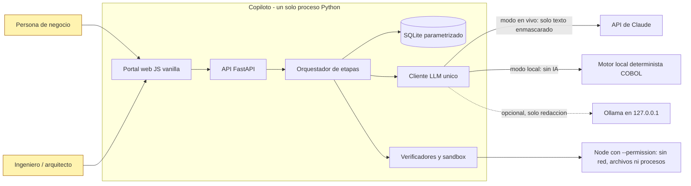
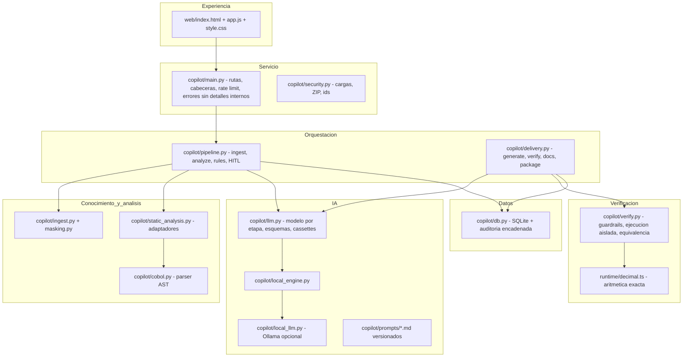
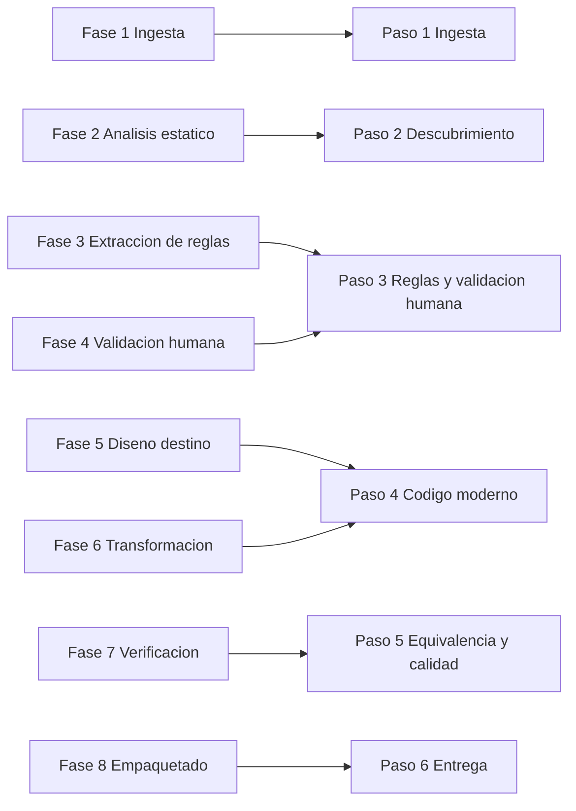
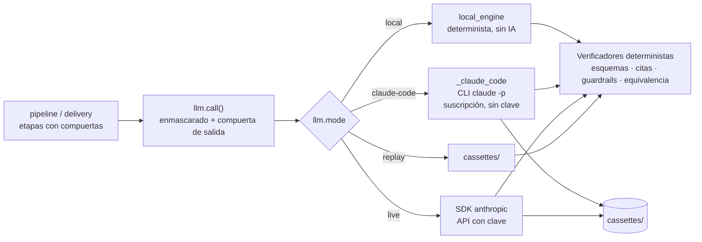
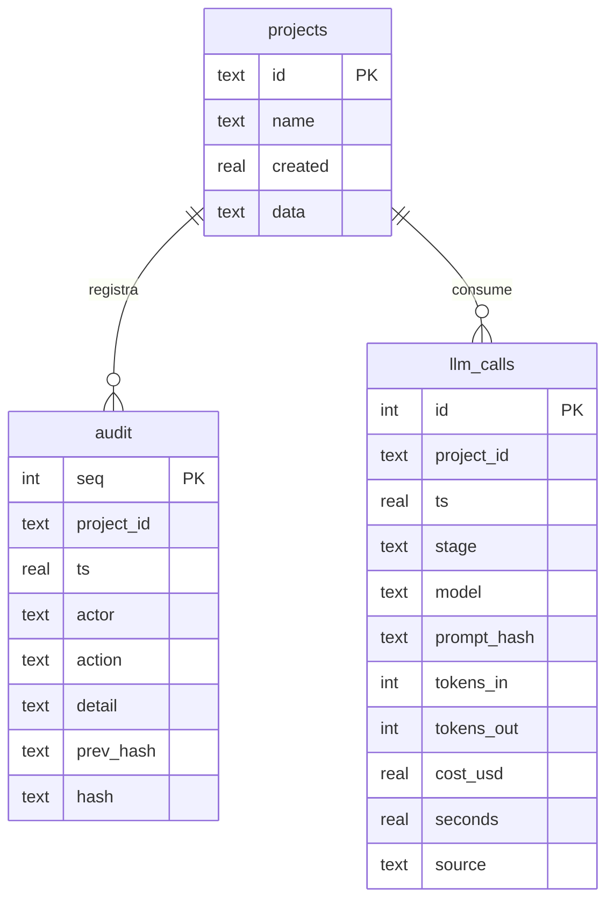
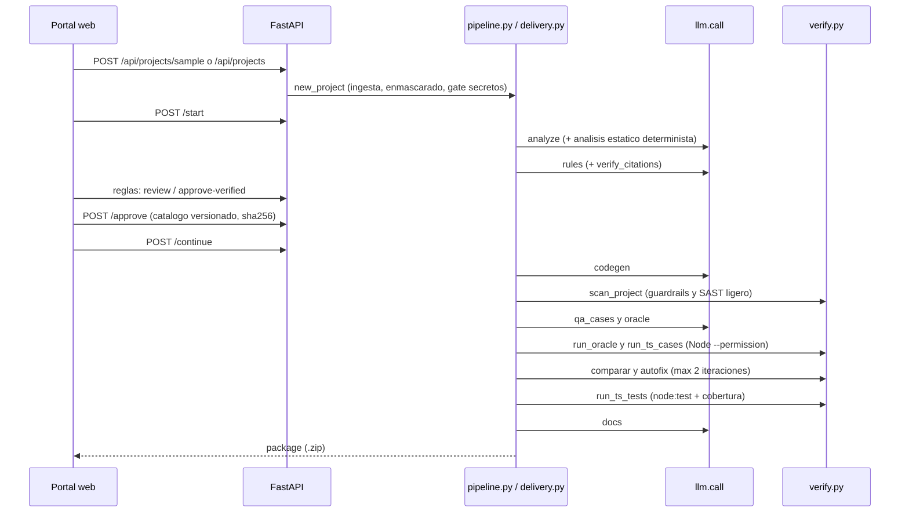

# Manual de usuario — Copiloto de Modernización y Descubrimiento de Código Legacy

> **Este es el manual COMBINADO** (negocio + técnico). Si su audiencia es solo funcional use el [Manual funcional (no técnico)](MANUAL_FUNCIONAL_NO_TECNICO.md); si es solo de ingeniería use el [Manual técnico](MANUAL_TECNICO.md). Inicio rápido: doble clic en `iniciar.bat` (Windows) o `py run.py`; diagnóstico: `py run.py --check`.

Este manual explica **qué es** la aplicación, **cómo está construida** (arquitectura y tecnologías), **cómo usarla** (para una persona no técnica y para una persona técnica) y **cómo presentarla** en la demostración. Todo lo que se afirma aquí está respaldado por el código del repositorio; donde algo es una limitación o no se ha probado, se dice explícitamente.

---

## 1. Qué es y para quién

**El problema.** Bancos y aseguradoras siguen operando cálculos críticos (cuotas de crédito, primas, siniestros) en programas antiguos (COBOL, PL/SQL, RPG, Java viejo) que casi nadie entiende ya y que no tienen documentación fiable. Entenderlos y migrarlos a mano toma semanas por rutina y arriesga errores financieros.

**La solución.** El Copiloto recibe el código antiguo y, de forma guiada:

1. lo carga y **oculta los secretos y datos personales** antes de usar cualquier inteligencia;
2. **descubre su estructura** (partes, dependencias, métricas, código muerto, riesgos);
3. **extrae las reglas de negocio**, cada una con la línea original que la respalda y un nivel de confianza;
4. deja que **una persona apruebe, ajuste o rechace** cada regla;
5. **genera código moderno** con arquitectura limpia (hexagonal) en Node.js/TypeScript;
6. **demuestra que el código nuevo se comporta igual** que el antiguo con decenas de casos (incluidos los límites) y tolerancia cero en cálculos y redondeos;
7. **entrega un paquete** con código, pruebas, documentación, matriz de trazabilidad, informe ejecutivo y reportes.

**Para quién es.**

| Perfil | Qué obtiene |
|---|---|
| Persona de negocio / auditoría | Catálogo de reglas en lenguaje claro, trazabilidad a las líneas originales, informe ejecutivo de una página y comparación contra hacerlo a mano. |
| Arquitecto / desarrollador | Código por capas (domain / application / infrastructure), pruebas automáticas, ADRs, contrato OpenAPI, reportes de calidad y seguridad. |
| Líder / patrocinador | Cifras de ahorro (parametrizables y explícitas), tiempos y costos de la ejecución. |

---

## 2. Arquitectura

### 2.1 Vista de contexto



Todo corre en **un único proceso** (`py run.py` → `uvicorn copilot.main:app`). No hay Docker ni base de datos externa.

### 2.2 Capas de la aplicación



### 2.3 Del flujo del reto (8 fases) a los 6 pasos de la interfaz

El documento del reto define un flujo de 8 fases con compuertas de calidad (quality gates). La interfaz las agrupa en 6 pasos:



| Fase del reto | Paso de la UI | Etapa en el código | Compuerta (gate) automática |
|---|---|---|---|
| 1. Ingesta y preparación | 1 · Ingesta | `ingest` (`pipeline.new_project`) | 0 secretos residuales tras enmascarar |
| 2. Análisis estático | 2 · Descubrimiento | `analyze` (`pipeline.analyze_stage`) | 100 % de unidades inventariadas con líneas válidas |
| 3. Extracción de reglas | 3 · Reglas | `rules` (`pipeline.rules_stage`) | 100 % de reglas con cita verificada (verificada o corregida) |
| 4. Validación humana | 3 · Reglas | `review` (`review_rule`, `approve_catalog`) | Aprobación explícita; no se aprueban reglas sin trazabilidad |
| 5–6. Diseño y transformación | 4 · Código | `generate` (`delivery.generate_stage`) | Capas presentes, sin violaciones de dependencia |
| 7. Verificación | 5 · Equivalencia | `verify` (`delivery.verify_stage`) | Equivalencia 100 %, 0 hallazgos críticos |
| 8. Empaquetado | 6 · Entrega | `docs` y `package` | Matriz de trazabilidad completa y diagramas válidos |

Cada transición escribe un evento en la auditoría (`db.audit`). Una compuerta fallida **no oculta resultados**: se informa en pantalla y el flujo continúa para que se vea el motivo; solo un error técnico detiene la cadena.

### 2.4 Orquestación multiagente

El reto pide agentes especializados coordinados por un orquestador con estado y puntos de aprobación humana. En el código el orquestador es una **máquina de estados** (`pipeline.py` y `delivery.py`) y cada agente es una **etapa con su propia plantilla de prompt versionada** y su esquema JSON de salida (`copilot/prompts/`, `copilot/schemas.py`):

| Agente | Etapa (`config/models.json`) | Plantilla | Qué produce |
|---|---|---|---|
| Analista | `analyze` | `analyze.md` | Unidades, dependencias, contrato de entrada/salida, riesgos, hallazgos de seguridad |
| Extractor de reglas | `rules` | `rules.md` | Catálogo de reglas con citas, confianza, Gherkin y tablas de decisión |
| Arquitecto + Desarrollador | `codegen` (+ `autofix`) | `codegen_typescript.md`, `codegen_java.md`, `codegen_csharp.md`, `autofix.md` | Diseño, ADRs, OpenAPI y archivos del proyecto; correcciones |
| QA | `oracle` y `qa_cases` | `oracle.md`, `qa_cases.md` | Referencia independiente en Python y casos de prueba |
| Documentador | `docs` | `docs.md` | Visión general, diccionario de datos, diagramas Mermaid, resumen ejecutivo |

Hay **cuatro modos de ejecución** de esos agentes (función `llm.mode()` en `copilot/llm.py`; se pueden cambiar en caliente desde el selector **«Motor»** de la interfaz, que usa `POST /api/mode`):

| Modo | Cuándo se activa | Qué hace |
|---|---|---|
| **Motor local determinista** (`local`) | No hay clave (modo `auto`) o `COPILOT_LLM=local` | `copilot/local_engine.py` implementa las mismas etapas **sin IA**: parsea el COBOL a un AST, extrae reglas del propio código, transpila a TypeScript y a Python y genera casos y documentación. |
| **Claude vía suscripción** (`claude-code`) — extensión con IA **sin clave de API** | **Solo de forma explícita:** `py run.py --claude`, `COPILOT_LLM=claude-code` o el selector «Motor». `auto` nunca lo elige. | `llm._claude_code` invoca el CLI `claude` (Claude Code) en modo no interactivo con la **suscripción** del usuario, por etapa, con salida estructurada (JSON Schema). Cualquier lenguaje; destinos TypeScript, Java y C#. Registra tokens, costo 0 y fuente `claude-code`, y **graba cassettes**. |
| **En vivo** (`live`) | Hay `ANTHROPIC_API_KEY` válida (o `COPILOT_LLM=live`) | Llama a la API de Claude (de pago por uso) con el modelo configurado por etapa, salida estructurada y reintento; **graba** cada respuesta en `cassettes/`. |
| **Contingencia** (`replay`) | `COPILOT_LLM=replay` | Reproduce las respuestas grabadas en `cassettes/` de una corrida **con IA** previa (`claude-code` o `live`); sin red ni IA. |

> Importante: el modo local **no graba** cassettes. Para tener contingencia "pregrabada" hace falta haber hecho antes al menos una corrida con IA (`claude-code` o `live`). El modo `claude-code` ya ha completado una corrida real con la muestra COBOL (véase 2.8).



La función `llm.call()` es el **único punto** por donde sale texto hacia cualquier modelo. Antes de enviar, ejecuta la compuerta de salida: si detecta un secreto o dato personal sin enmascarar lanza `EgressBlocked` y **no envía nada**. Esto aplica también al modo `claude-code`.

### 2.5 Modelo de datos

SQLite (`data/copilot.db`) con tres tablas, siempre con consultas parametrizadas (`copilot/db.py`):



- `projects.data` guarda el estado completo del proyecto en JSON (artefactos enmascarados, reglas, generación, verificación, documentación, paquete).
- `audit` es una **cadena de hashes**: cada evento incluye el hash del anterior; si alguien altera un registro, `db.verify_audit_chain` lo detecta.
- `llm_calls` guarda tokens, costo, latencia y **procedencia** (`local`, `claude-code`, `live`, `replay`; en `local` y `claude-code` el costo es 0). Los prompts se guardan solo como hash corto (16 caracteres), nunca el código completo.

### 2.6 Seguridad por capas

| Capa | Control | Dónde |
|---|---|---|
| Entrada | Límites (2 MB por archivo, 20 MB totales, 300 archivos), extensiones permitidas, archivos binarios (en un ZIP con varios archivos se omiten y se listan en la pantalla de Ingesta; si todos lo son, se rechaza nombrando el archivo), basura de macOS en el ZIP ignorada (`__MACOSX`, `._*`, `.DS_Store`), ZIP-slip, enlaces simbólicos y ZIP-bomb (relación de compresión > 200) | `copilot/security.py`, `copilot/ingest.py` |
| Datos | Enmascarado de secretos/PII conservando el número de líneas; compuerta de salida que bloquea el envío | `copilot/masking.py`, `copilot/llm.py` |
| Persistencia | SQL solo parametrizado; borrado de proyecto que purga auditoría y llamadas | `copilot/db.py` |
| API | Cabeceras CSP/X-Frame-Options/nosniff, rate limit (240 solicitudes por minuto y por IP), errores sin trazas, identificadores validados (32 hex) | `copilot/main.py`, `copilot/security.py` |
| Interfaz | Todo el contenido dinámico se inserta como nodos de texto; no se usa `innerHTML` | `web/app.js` (lo comprueba una prueba) |
| Modelo | Código legacy delimitado como dato no confiable (prompt injection), salidas con JSON Schema, citas verificadas de forma determinista | `copilot/prompts/common.md`, `pipeline.verify_citations` |
| Proveedor `claude-code` | CLI invocado con `--tools ""` (sin herramientas), `--no-session-persistence`, prompt por stdin, directorio de trabajo temporal vacío y `ANTHROPIC_API_KEY` eliminada del entorno hijo; mismo enmascarado y mismos verificadores que el resto de modos | `copilot/llm.py` (`_claude_code`), `tests/test_modes.py` |
| Ejecución | Código generado analizado estáticamente (eval, fetch, process, fs, SQL concatenado, float en importes) y ejecutado con permisos restringidos de Node; oráculo Python validado por AST (solo `decimal` y `math`) y con builtins restringidos | `copilot/verify.py` |
| Auditoría | Cadena de hashes verificable | `copilot/db.py` |

### 2.7 Decisiones y límites honestos

Estas son limitaciones reales; conviene decirlas en la demostración antes de que las pregunten:

1. **Java y C# solo con IA (`claude-code` o `live`).** El motor local solo genera Node.js/TypeScript. Incluso con IA, Java y C# se generan y se validan **estáticamente** (arquitectura, tipos numéricos, seguridad) pero **no se compilan ni se ejecutan** en esta máquina (no hay JDK ni .NET). La equivalencia ejecutada se demuestra con TypeScript.
2. **No se ejecuta el legacy.** No hay runtime COBOL/PL/SQL en el entorno. La equivalencia se declara con niveles de evidencia: **E2** (casos esperados aportados por el cliente, p. ej. `golden/cobol_amortizacion/cases.json`) y **E3** (oráculo independiente derivado del código legacy). El nivel E1 (legacy ejecutado) está definido en el diseño pero no se alcanza. La interfaz nunca presenta E3 como ejecución del legacy.
3. **El motor local cubre un subconjunto de COBOL de formato fijo** (MOVE, COMPUTE, ADD, SUBTRACT, MULTIPLY, DIVIDE, IF/ELSE, EVALUATE, PERFORM, GO TO, GOBACK, y E/S/EXEC SQL reconocidas como infraestructura). Una construcción fuera del subconjunto detiene la etapa con la línea exacta; nunca se ignora en silencio. Otros lenguajes (PL/SQL, RPG, Java) requieren la API de Claude.
4. **Reglas rechazadas en modo local.** El motor local transpila el programa completo; si se rechaza una regla, el código no la excluye (queda anotado como supuesto en el diseño).
5. **SQLite y sin Docker.** El MVP usa un archivo SQLite local y un solo proceso. PostgreSQL, colas y contenedores son hoja de ruta (ver `docs/plan/`).
6. **Git solo de lectura y sin RAG.** La carga es por archivo, ZIP, pegado o URL de un repositorio Git **público** (se descarga una copia del código; no se clona ni se modifica el repositorio; repos privados no se admiten; sin probar en vivo, ADR-017). El tamaño máximo de código es 400 000 caracteres (`max_source_chars`).
7. **Ollama (modelo de IA local opcional) no se ha probado en vivo en esta máquina.** Su integración (`copilot/local_llm.py`) solo se verificó con pruebas simuladas (`test_optional_local_model_enrichment_is_safe`, `test_local_model_host_must_be_loopback`). Está desactivada por defecto y, si falla, se conserva el texto determinista.
8. **Costos y ahorro.** Los costos de IA en modo `live` se miden (tokens × precios de `config/models.json`); en `local` y `claude-code` se registran con costo 0 (en `claude-code` el consumo cuenta contra los límites de la suscripción, no se factura por API). Las cifras de ahorro contra el proceso manual salen de **supuestos parametrizables** (`config/estimates.json`), no de mediciones.
9. **Modo `claude-code`: datos y dependencias.** El código **ya enmascarado** sale hacia Anthropic a través de la sesión de Claude Code del usuario (revise la política de su organización antes de usarlo con código real). Depende de que el comando `claude` esté en el `PATH` con la sesión iniciada y de los límites del plan. Una corrida completa tarda unos **6 minutos**. Solo se ha probado con COBOL; **PL/SQL, RPG y Java no se han probado** en esta máquina. Los resultados de un LLM pueden variar entre ejecuciones; la garantía son los verificadores deterministas.

### 2.8 Resultado real con Claude vía suscripción (una corrida)

Muestra COBOL `cobol_amortizacion`, con casos aportados (E2), modo `claude-code`, **346 s en total**:

| Etapa | Modelo | Tiempo |
|---|---|---|
| Análisis (`analyze`) | Sonnet 5.5 | 32 s |
| Reglas (`rules`) | Opus 5.5 | 87 s |
| Código (`codegen`) | Sonnet 5.5 | 106 s |
| Oráculo (`oracle`) | Opus 5.5 | 33 s |
| Casos de QA (`qa_cases`) | Sonnet 5.5 | 30 s |
| Documentación (`docs`) | Sonnet 5.5 | 53 s |

Resultados: **14 reglas**, todas con cita verificada (confianza 0,85–0,98); equivalencia **65/65** (E2 + E3), 0 diferencias; cobertura **98,43 %** de líneas y **94,79 %** de ramas; 0 hallazgos; complejidad ciclomática máxima 3; 0 iteraciones de autocorrección; trazabilidad 100 %. Es **una sola corrida**: otra ejecución puede dar un número distinto de reglas o código distinto, y los verificadores decidirán si pasa.

---

### 2.9 Interfaz y accesibilidad (estándares cumplidos)

La interfaz (`web/index.html`, `web/app.js`, `web/guide.js`, `web/style.css`, `web/favicon.svg`) es JavaScript sin dependencias y está pensada para personas no técnicas (ver ADR-016).

**Qué incluye**
- **Favicon SVG propio** (`web/favicon.svg`, también usado como logotipo de la cabecera) y `theme-color` (#2f5bea).
- **Portada de un solo botón:** tres pasos explicados y «▶ Probar con un ejemplo (opcional)» (carga la muestra COBOL con los casos aportados E2); guía en el botón flotante «?» (disponible en todas las pantallas; abre la explicación de la pantalla actual; mientras la guía está abierta el scroll manual se bloquea para que el marco no se desalinee); «＋ Nuevo proyecto» (panel Proyectos) vuelve al inicio y enfoca el formulario «Cargar su código»; botón de modo claro/oscuro (🌙/☀️, se recuerda en `localStorage`); tarjeta «👋 ¿Primera vez aquí?» (se recuerda en `localStorage`).
- **Guía interactiva** (`web/guide.js`): botón flotante «?» (abajo a la izquierda, en todas las pantallas). Oscurece la pantalla, enmarca el elemento real y lo explica en lenguaje simple (Anterior / Siguiente / Salir; teclas ←, →, Esc). Pasos por recorrido: portada 9, Ingesta 3, Descubrimiento 5, Reglas 7, Código 3, Equivalencia 3, Entrega 5.
- **Ayudas «ⓘ»** junto a las cifras técnicas (glosario de 20 términos en lenguaje simple).
- **Navegación por pasos:** menú de pasos numerados (✔ si están hechos; atenuados y con aviso mientras estén bloqueados) y barra inferior fija «← Paso anterior / Siguiente: <paso> →» con el aviso «🔒 qué falta para continuar» y «Empezar de nuevo» en el último paso.
- **Paso 3 compacto:** barra de progreso, filtros Todas / Pendientes / Aprobadas / Rechazadas, una línea por regla con ✔/✖ rápidos, «Aprobar y seguir», «Ajustar», «Rechazar y seguir»; «Aprobar catálogo y generar código →» queda deshabilitado hasta decidir todas. Tablas largas en cuadros con desplazamiento.

**Estándares de interfaz moderna**
- Tipografía: pila de sistema (`system-ui`, Segoe UI, Roboto…), tamaño base de 16 px, interlineado 1,55 y escala (h1 fluido 26–36 px, h2 22 px, h3 18 px). Sin fuentes externas: funciona sin internet.
- Color: variables CSS (`--ink`, `--mute`, `--ok`, `--warn`, `--bad`, `--btn`, `--okbtn`, `--badbtn`…), **modo claro y oscuro** automáticos (`prefers-color-scheme`).
- Accesibilidad: enlace «Saltar al contenido», foco visible (`:focus-visible`, contorno de 3 px), regiones `aria-live` para avisos y progreso, `aria-current="step"` en el paso activo, `lang="es"`, objetivos táctiles de al menos 42 px, `prefers-reduced-motion`, adaptable a pantallas de 720 px o menos.
- Seguridad de la UI: todo el contenido dinámico se inserta como nodos de texto; no hay `innerHTML`, `eval` ni `new Function` en `app.js` ni `guide.js` (lo verifica una prueba).

**Auditoría de contraste (WCAG AA, mínimo 4,5:1)** — cifras calculadas desde los valores reales de `web/style.css`:

| Par de colores | Modo claro | Modo oscuro |
|---|---|---|
| `--ink` sobre `--bg` | 14,89 | 15,79 |
| `--ink` sobre `--card` | 16,10 | 14,15 |
| `--mute` sobre `--bg` | 6,14 | 7,36 |
| `--mute` sobre `--card` | 6,64 | 6,60 |
| `--mute` sobre `--line` | 5,32 | 4,91 |
| `--ok` sobre `--okbg` | 5,48 | 7,00 |
| `--warn` sobre `--warnbg` | 4,65 | 7,35 |
| `--bad` sobre `--badbg` | 5,52 | 7,02 |
| Texto blanco sobre `--btn` (botones) | 5,52 | 5,35 |
| Texto blanco sobre `--okbtn` (botones) | 6,17 | 5,29 |
| Texto blanco sobre `--badbtn` (botones) | 6,54 | 5,47 |

Se corrigieron en esta revisión: `--ok` sobre `--okbg` (4,37 → 5,48), `--mute` sobre `--line` (4,49 → 5,32) y el texto blanco de los botones en modo oscuro (2,88 → 5,35 al separar el token `--btn` de `--brand`).

**Verificación automática:** `tests/test_ui_standards.py` (6 pruebas): contraste de texto y botones en ambos modos, favicon y metadatos, favicon servido por la app, accesibilidad básica, existencia de la guía y glosario, ausencia de sumideros XSS. **No se ha medido** la usabilidad con una persona real ni con lectores de pantalla; el criterio de usuario externo sigue pendiente (`AC-F6-MANUAL-01`).

Para entrenarse con la interfaz: [GUIA_ENTRENAMIENTO_DEMO.md](GUIA_ENTRENAMIENTO_DEMO.md).

## 3. Tecnologías

| Tecnología | Para qué se usa | Por qué |
|---|---|---|
| **Python 3.10+** (verificado con 3.15) y **FastAPI + uvicorn** | API, orquestador, verificadores | Ecosistema de IA maduro, validación estricta, un solo proceso fácil de arrancar. |
| **Pydantic** | Validación de cuerpos de petición | Tipos y longitudes estrictas en la frontera. |
| **SQLite** (módulo `sqlite3`) | Persistencia de proyectos, auditoría y llamadas al modelo | Cero instalación; consultas **siempre parametrizadas** (hay una prueba que lo exige y otra de inyección SQL). |
| **JavaScript vanilla** (sin frameworks, sin `innerHTML`) | Portal web | Sin cadena de compilación; superficie de XSS mínima. |
| **SDK `anthropic`** | Modo en vivo (`live`) con la API de Claude | Salida estructurada con `output_config.format` (JSON Schema), streaming y `effort` por etapa. **No probado en vivo** (no hubo clave de API). |
| **CLI `claude` (Claude Code)** | Modo `claude-code`: Claude con la suscripción, sin clave de API | `claude -p --output-format json --json-schema …` con `--tools ""`, `--no-session-persistence`, `--model <id>` y `--effort <nivel>`; prompt por stdin (evita el límite de línea de comandos de Windows). Probado con una corrida completa sobre la muestra COBOL. |
| **Modelos Claude por etapa** (`config/models.json`) | Haiku 5.5 (detección), Sonnet 5.5 (análisis, código, casos, docs), Opus 5.5 (reglas y oráculo) | Modelo adecuado por costo/calidad, configurable sin tocar código. |
| **Node.js reciente** | Ejecutar y probar el código TypeScript generado | Ejecuta `.ts` directamente (type stripping), modelo de permisos (`--permission`), `node:test` con cobertura. Verificado con v26.13.1; se necesita una versión reciente (24 o superior recomendada). |
| **`runtime/decimal.ts`** (Decimal propio con BigInt) | Aritmética exacta con escala, `ROUNDED` (HALF_UP), truncamiento y truncado de `PIC` | Evita `float/double` en importes; reproduce la semántica COBOL. Provisto por la plataforma al código generado. |
| **Parser COBOL propio** (`copilot/cobol.py`) | AST del programa (subconjunto) | Base determinista del motor local y del analizador estático. |
| **Ollama** (opcional) | Redactar descripciones de reglas y resumen ejecutivo con un modelo local gratuito | Sin clave ni Internet; solo loopback; no cambia la lógica. **No probado en vivo aquí.** |
| **pytest + httpx** | 121 pruebas unitarias, de integración y de seguridad | Reproducibles y rápidas (~12 s). |
| **Script de aceptación** (`scripts/acceptance/run_acceptance.py`) | Verifica criterios por fase con reportes `.md/.json` y código de salida | Multiplataforma, solo biblioteca estándar. |
| **Mermaid** | Diagramas en la documentación | Texto versionable. |

---

## 4. Instalación y arranque

**Requisitos:** Python (con el lanzador `py` en Windows) y Node.js reciente. No hace falta Docker.

```powershell
# 1) (Opcional) clave de la API: edite el archivo .env en la raiz del proyecto
#    ANTHROPIC_API_KEY=sk-ant-...
# 2) Arrancar (crea .venv e instala dependencias la primera vez)
py run.py
#    Opcional: Claude con su suscripción de Claude Code, SIN clave de API
py run.py --claude
# 3) Abrir http://127.0.0.1:8000  (el motor de IA también se cambia desde el selector «Motor»)
```

Para el modo `claude-code`: el comando `claude` debe estar en el `PATH` y la sesión iniciada (ejecute `claude` una vez de forma interactiva y entre con su cuenta). La aplicación detecta el CLI automáticamente; si no existe, la opción aparece como «no disponible».

En Linux/macOS use `python3 run.py`. En Windows **no** use `python`: en muchos equipos es el alias de la Microsoft Store.

### 4.1 Variables de entorno y archivo `.env`

| Variable | Valores | Efecto |
|---|---|---|
| `ANTHROPIC_API_KEY` | `sk-ant-…` | Activa el modo en vivo (si `COPILOT_LLM` es `auto`). Una clave de ejemplo o incompleta (menos de 30 caracteres o que contenga "REEMPLACE") **se ignora** y se trata como "sin clave". |
| `COPILOT_LLM` | `auto` (por defecto), `local`, `claude-code`, `live`, `replay` | Fuerza el modo. En `auto`: con clave → `live`; sin clave → `local` (**`auto` nunca elige `claude-code`**: es una extensión explícita). `py run.py --claude` equivale a `COPILOT_LLM=claude-code`. `py run.py --rapido` (o `COPILOT_PROFILE=fast`) activa el perfil de modelos rápido (ADR-018). El selector de la UI tiene prioridad mientras el servidor esté en marcha (`MODE_OVERRIDE`). |
| `COPILOT_OLLAMA_MODEL` | p. ej. `qwen2.5:7b` | Activa el enriquecimiento opcional con un modelo local de Ollama (solo textos). Requiere Ollama instalado y en ejecución. |
| `COPILOT_OLLAMA_HOST` | por defecto `http://127.0.0.1:11434` | Solo se aceptan direcciones de loopback. |
| `COPILOT_CASSETTES` | ruta | Carpeta de cassettes (por defecto `cassettes/`). |
| `COPILOT_HOST`, `COPILOT_PORT` | por defecto `127.0.0.1` y `8000` | Dónde escucha el servidor. |

El archivo `.env` se carga automáticamente y está excluido de Git. **No comparta ni pegue su clave en chats o documentos.**

### 4.2 Cómo saber en qué modo está

El selector **«Motor»** (arriba a la derecha) muestra el motor activo y la insignia de al lado lo resume (**Sin IA**, **Claude** o **Pregrabado**):

- **⚙ Motor local determinista (sin IA)** — sin clave; todo se deriva del código de forma determinista.
- **◆ Con IA** — Claude trabaja a través de su sesión de Claude Code.
- **● IA en vivo (API de Claude)** — hay una clave de API válida.
- **■ Contingencia (pregrabado)** — reproduce cassettes.

Los motores no disponibles aparecen deshabilitados con «— no disponible». El mismo dato lo devuelve `GET /api/status` (`mode`, `has_key`, `local_model`, `available_modes`, `models`).

---

## 5. Usuario no técnico

Esta sección está escrita para una persona de negocio, auditoría o dirección. No necesita saber programar.

### 5.1 Idea general en una frase

La aplicación **lee un programa antiguo, le explica qué reglas de negocio contiene, le pide a usted que las apruebe y después construye el programa nuevo y demuestra que da exactamente los mismos resultados**.

### 5.2 Antes de empezar

1. Pida a quien instaló la aplicación que la abra en `http://127.0.0.1:8000`.
2. Mire el selector **«Motor»** de arriba a la derecha: le dice qué usa la aplicación para "pensar". Hay hasta cuatro opciones y todas siguen el mismo recorrido:
   - **Motor local (sin IA):** el programa sigue reglas fijas; es rápido (segundos) y funciona sin Internet, pero **solo entiende programas COBOL de cierto tipo**.
   - **Claude vía suscripción:** una inteligencia artificial (Claude) lee el programa; sirve para **cualquier lenguaje antiguo**, pero tarda unos **6 minutos** por programa y **el código —ya sin claves ni datos personales— se envía a Anthropic**. Solo aparece disponible si su equipo tiene Claude Code con la sesión iniciada.
   - **IA en vivo (API)** y **Pregrabado:** opciones para quien administra la aplicación.
   Para cambiar de motor, abra el selector y elija otra opción **antes de empezar un proyecto nuevo**.
3. En cada paso verá un recuadro amarillo **"🧭 Paso N"** con la explicación y un renglón **"Qué hacer ahora"**. Siga esa instrucción.

### 5.3 Pantalla de inicio

- **Muestras sintéticas:** programas de ejemplo con datos inventados. Pulse **Usar esta muestra** en la de COBOL (cálculo de cuota de préstamo). Si marca "Incluir casos esperados aportados", la prueba de equivalencia usará además resultados esperados escritos aparte (evidencia E2).
- **Cargar su código:** suba archivos o un ZIP, o pegue el código. Use **solo datos sintéticos o ya anonimizados**.
- **Demostrar el manejo de entradas inválidas:** botones que envían a propósito un archivo `.exe`, un archivo binario o un texto vacío. La aplicación debe rechazarlos con un mensaje claro y sin guardar nada.

### 5.4 Los 6 pasos

**Paso 1 · Ingesta (carga y enmascarado).**
- *Qué verá:* cuántos archivos y líneas hay, el lenguaje detectado y un cuadro de "Informe de enmascarado".
- *Qué significa:* si en el código había contraseñas, correos, cuentas bancarias o claves, se reemplazaron por marcas como `<SECRET_001>` **antes** de usar cualquier inteligencia. La "compuerta" debe decir **Compuerta superada** (cero residuos).
- *Qué pulsar:* **Analizar y extraer reglas →**.

**Paso 2 · Descubrimiento.**
- *Qué verá:* un "mapa" del programa: líneas de código, número de partes, complejidad, código muerto (partes que nunca se ejecutan), tablas usadas, qué parte llama a cuál, y el mapa de riesgo.
- *Qué significa:* cada parte se clasifica como **business** (negocio), **infrastructure** (lectura de archivos, mensajes, base de datos) o **mixed**. El "contrato de entrada/salida" lista los datos que entran (por ejemplo monto, plazo) y los que salen (cuota, tasa).
- *Qué pulsar:* nada; revise y pase al paso 3 con el menú superior.

**Paso 3 · Reglas (usted decide).**
- *Qué verá:* a la izquierda el código original; a la derecha tarjetas, una por regla. Al hacer clic en una tarjeta se resaltan en el código las líneas que la respaldan.
- *Etiquetas:*
  - **cita verificada** (verde): la línea citada existe y contiene lo que la regla dice;
  - **línea corregida** (amarillo): la cita estaba cerca; el sistema corrigió el número de línea;
  - **SIN respaldo en el código** (rojo): la regla es sospechosa (posible invención del modelo) y **no se puede aprobar**;
  - **pendiente / aprobada / rechazada**: estado de su decisión;
  - **requiere revisión**: confianza baja.
- *Barra de confianza:* qué tan segura está la herramienta de la regla.
- *Qué pulsar:* **Aprobar** (verde), **Ajustar** (para editar la descripción y aprobar), **Rechazar** (rojo, con comentario opcional). Para ir rápido: **Aprobar todas las verificadas**. Cuando todas estén decididas: **Aprobar catálogo y generar código →**.
- *Importante:* ninguna regla llega al código nuevo sin su aprobación explícita; todo queda en un registro de auditoría con su nombre de revisor.

**Paso 4 · Código moderno.**
- *Qué verá:* el diseño de arquitectura, cuántos archivos se generaron, las "capas" y la **vista comparativa**: elija una regla arriba y verá a la izquierda su línea original y a la derecha el archivo nuevo donde quedó implementada (marcado con ●).
- *Qué significa:* el código nuevo está ordenado por capas (domain = reglas de negocio, application = casos de uso, infrastructure = conexiones). Las decisiones de diseño aparecen como "ADRs".

**Paso 5 · Equivalencia.**
- *Qué verá:* el porcentaje de casos en que el sistema nuevo da **exactamente** el mismo resultado que el antiguo, las diferencias en cálculos (debe ser **0**), la cobertura de pruebas y los hallazgos críticos (debe ser **0**).
- *Nivel de evidencia:* **E2** = resultados esperados aportados por el cliente; **E3** = resultados calculados por una referencia independiente derivada del código antiguo. La aplicación aclara que **no se ejecutó el programa antiguo**.
- *Tabla de casos:* cada fila es una situación (por ejemplo, "monto justo en el límite"). Verde = equivalente; rojo = diferencia.

**Paso 6 · Entrega.**
- *Qué verá:* el tablero (reglas aprobadas, trazabilidad, equivalencia, cobertura, tiempo, costo), el resumen ejecutivo, la comparación contra hacerlo a mano, **¿Qué nos diferencia?**, el **Caso de negocio** (calculadora de ahorro) y la matriz de trazabilidad.
- *Qué pulsar:* **⬇ Descargar paquete de migración (.zip)**. En la calculadora cambie "Rutinas legacy a migrar" para ver el ahorro estimado de toda una cartera.

### 5.5 Qué hacer si algo sale mal

Si aparece una franja roja con un error, léala: incluye una **acción sugerida** y un botón **Reintentar**. Los mensajes nunca muestran el código ni datos internos.

### 5.6 Glosario simple

| Término | Significado |
|---|---|
| **Legacy** | Programa antiguo, normalmente sin documentación. |
| **Regla de negocio** | Una política del negocio escrita en el código (por ejemplo, "el monto mínimo es 1,000"). |
| **Trazabilidad** | Poder señalar la línea exacta del código antiguo que respalda cada regla. |
| **Enmascarado** | Reemplazar datos sensibles por marcas antes de procesarlos. |
| **Validación humana** | Una persona aprueba, ajusta o rechaza cada regla. |
| **Equivalencia** | Demostrar que el sistema nuevo da los mismos resultados que el antiguo. |
| **Caso borde** | Situación en el límite (monto mínimo, plazo máximo…) donde suelen aparecer errores. |
| **Redondeo / truncamiento** | Cómo se recortan los decimales; la diferencia de un centavo cuenta como error. |
| **Arquitectura hexagonal** | Forma de ordenar el código para separar el negocio de la tecnología. |
| **Motor local (sin IA)** | Modo que funciona sin clave de IA, derivando todo del código. |

---

## 6. Usuario técnico

### 6.1 Flujo de extremo a extremo



Detalles relevantes:

- **Análisis** (`analyze_stage`): corre el analizador estático (`static_analysis.analyze_all`: adaptador COBOL determinista o genérico heurístico), construye el prompt con el código numerado dentro de `<legacy_source>` y valida la salida con `schemas.validate`. Calcula la recuperación del inventario frente a los párrafos detectados de forma determinista y añade hallazgos de seguridad deterministas (SQL dinámico concatenado, intentos de prompt injection, secretos).
- **Reglas** (`rules_stage`): valida el esquema, renumera ids duplicados, y `verify_citations` comprueba cada cita (archivo, rango y que el texto citado esté en el código; si está en otro lugar corrige el rango; si no, marca `failed` y baja la confianza a ≤ 0,3).
- **Revisión** (`review_rule`, `approve_catalog`): no permite aprobar reglas con trazabilidad fallida (editar el texto no corrige la cita: hay que rechazarlas); el catálogo aprobado se versiona con un SHA-256.
- **Generación y verificación** (`delivery.py`): `generate_stage`, `verify_stage` (casos de QA + oráculo + equivalencia + pruebas unitarias con cobertura + hasta 2 iteraciones de autocorrección), `docs_stage` (documentación y matriz de trazabilidad) y `package_stage` (zip).
- **Equivalencia:** `verify.compare` compara campo a campo con tolerancia 0 (decimales por valor numérico exacto); una diferencia de un centavo cuenta como fallo.

### 6.2 API REST

Todas las rutas están bajo `/api`; el cuerpo es JSON salvo la carga (multipart). Los identificadores de proyecto son 32 caracteres hexadecimales.

| Método y ruta | Descripción |
|---|---|
| `GET /api/status` | Modo activo (`local`/`claude-code`/`live`/`replay`), si hay clave, modelo local (Ollama) detectado, `available_modes` (qué modos se pueden usar), modelos por etapa y versión. |
| `POST /api/mode` | Cambia el motor de IA en caliente. Cuerpo: `{"mode": "local|claude-code|live|replay"}`. Devuelve el estado como `GET /api/status`; responde 400 si el modo no está disponible (p. ej. `live` sin clave o `claude-code` sin el CLI `claude`). |
| `GET /api/samples` | Lista de muestras sintéticas del directorio `golden/`. |
| `POST /api/projects/sample` | Crea un proyecto desde una muestra. Cuerpo: `{"name": "cobol_amortizacion", "target": "typescript", "with_cases": false}`. |
| `POST /api/projects/repo` | Crea un proyecto desde un repositorio Git público (solo lectura). Cuerpo: `{"url": "https://github.com/org/repo", "ref": "", "subdir": "", "name": "", "target": "typescript"}`. Hosts: github.com, gitlab.com, bitbucket.org, codeberg.org. |
| `POST /api/projects` | Crea un proyecto subiendo archivos/ZIP o código pegado. Campos multipart: `files`, `code_text`, `code_name`, `name`, `domain`, `target`, `style`, `cases_json`. |
| `GET /api/projects` | Lista de proyectos. |
| `GET /api/projects/{pid}` | Estado completo del proyecto (artefactos, etapas, reglas, generación, verificación, métricas, resumen de llamadas al modelo). |
| `DELETE /api/projects/{pid}` | Borra el proyecto, su auditoría, llamadas y paquete. |
| `POST /api/projects/{pid}/start` | Lanza análisis y extracción de reglas (en segundo plano). |
| `POST /api/projects/{pid}/rules/{rid}/review` | Decide una regla. Cuerpo: `{"status": "approved|rejected|proposed", "edits": {...}, "comment": "..."}`. El revisor sale de la cabecera `X-Reviewer`. |
| `POST /api/projects/{pid}/rules/approve-verified` | Aprueba en lote las reglas pendientes con cita verificada o corregida. |
| `POST /api/projects/{pid}/approve` | Cierra y versiona el catálogo (exige todas las reglas decididas y al menos una aprobada). |
| `POST /api/projects/{pid}/continue` | Lanza generación → verificación → documentación → paquete. |
| `GET /api/projects/{pid}/audit` | Auditoría y si la cadena de hashes es íntegra. |
| `GET /api/projects/{pid}/download` | Descarga el paquete `.zip`. |

Las etapas son asíncronas: el cliente consulta `GET /api/projects/{pid}` cada ~1,5 s (la interfaz lo hace sola). Cada etapa tiene estado `pending`, `running`, `done`, `gate_failed` o `failed`.

### 6.3 Estructura del repositorio

```
copilot/           API y lógica (main, pipeline, delivery, llm, local_engine, local_llm, cobol,
                   ingest, masking, static_analysis, verify, security, db, schemas)
copilot/prompts/   Plantillas versionadas por agente (common, analyze, rules, codegen_*, oracle, qa_cases, docs, autofix)
web/               Portal (index.html, app.js, style.css)
runtime/decimal.ts Aritmética decimal exacta provista al código generado
config/            models.json (modelo por etapa y precios), estimates.json (supuestos de ahorro)
golden/            Muestras sintéticas (cobol_amortizacion, plsql_siniestro, adversarial) y casos de referencia
cassettes/         Respuestas grabadas del modo en vivo (para el modo replay)
scripts/acceptance Ejecutor de criterios de aceptación
tests/             Pruebas (unitarias, e2e, seguridad, motor local) y fixtures
docs/              Manual, rúbrica, guion de demo y plan (docs/plan/)
data/, reports/    Datos locales (SQLite, paquetes) y reportes de aceptación (no versionados)
```

### 6.4 Pruebas y aceptación

```powershell
.\.venv\Scripts\python -m pytest tests -q        # 121 pruebas (5 de ellas en tests/test_modes.py: modo claude-code)
py scripts\acceptance\run_acceptance.py --fase 7   # una fase (0..7)
py scripts\acceptance\run_acceptance.py --todas    # regresión completa
```

- Resultado por criterio: `PASS`, `FAIL`, `SKIP`, `MANUAL-VERIFICADO` o `MANUAL-PENDIENTE`; código de salida distinto de 0 si algo falla. Reportes en `reports/acceptance/fase_<N>_<fecha>.md` y `.json`. La opción `--estricto` cuenta los criterios manuales pendientes como fallo.
- El criterio manual `AC-F6-MANUAL-01` exige el archivo `evidence/AC-F6-MANUAL-01.json` con `reviewer`, `date` y `checklist_completed` (véase `docs/RUBRICA_Y_EVIDENCIAS.md`).
- `tests/test_modes.py` (sin llamar a ningún modelo) comprueba que `_claude_code` invoca el CLI aislado y **sin clave** (`--tools ""`, `--no-session-persistence`, prompt por stdin, directorio temporal, sin `ANTHROPIC_API_KEY`), que los errores se reportan con claridad, que se graba el cassette con costo 0, que `POST /api/mode` cambia o rechaza modos y que `auto` nunca elige `claude-code`. La corrida **real** con Claude (sección 2.8) se hizo aparte, a mano.
- Las pruebas con "proveedor simulado" (`tests/fake_llm.py`) **no son salidas de un modelo real**; sirven para validar la maquinaria. El script de aceptación fuerza `COPILOT_LLM=replay` en su entorno.

Cifras verificadas con el motor local sobre la muestra COBOL (`cobol_amortizacion`, con casos aportados): **11 reglas**, todas con cita verificada; **67 de 67** casos de equivalencia (25 aportados E2 + 42 derivados E3), **0** diferencias numéricas; cobertura **93,67 %** de líneas y **83,33 %** de ramas; complejidad ciclomática máxima 10; 0 hallazgos críticos; trazabilidad 100 %.

### 6.5 Cómo extender

- **Nuevo lenguaje de origen:** implemente la interfaz `LanguageAdapter` de `copilot/static_analysis.py` (métodos `supports(language)` y `analyze(artifact)`) y regístrelo en la lista `ADAPTERS` antes del adaptador genérico. Añada detección en `ingest.detect_language` si hace falta. Con la API en vivo, el adaptador genérico ya permite que el modelo trabaje sobre cualquier lenguaje con menor rigor determinista.
- **Prompts:** edite `copilot/prompts/*.md`. El texto común de seguridad (`common.md`) se antepone a todos. Los esquemas de salida están en `copilot/schemas.py` (se endurecen automáticamente con `llm.strictify`).
- **Modelos por etapa:** `config/models.json` (campos `model` y `effort` por etapa, precios por millón de tokens, `max_source_chars`). No hay IDs de modelo fijos en el código.
- **Supuestos de ahorro:** `config/estimates.json` (LOC por hora de análisis y de migración, fracción de documentación, minutos de revisión humana por rutina, tarifa y horas por día).
- **Golden dataset:** cada muestra en `golden/<nombre>/` tiene `manifest.json` (con `files`, `title`, `description`) y, opcionalmente, `cases.json` con `input` y `expected`. `reference.py` es la referencia escrita a mano del caso COBOL.
- **Modo `claude-code`:** `copilot/llm.py` → `claude_cli()` localiza el ejecutable (`shutil.which("claude")`), `available_modes()` decide qué opciones se ofrecen, `set_mode()` valida y fija `MODE_OVERRIDE`, y `_claude_code()` construye la invocación (`--output-format json`, `--tools ""`, `--no-session-persistence`, `--model`, `--effort`, `--system-prompt`, `--json-schema` con el esquema endurecido por `strictify`) y lee `structured_output` del JSON de respuesta. Los modelos y el esfuerzo salen de `config/models.json`. El timeout por etapa es de 900 s.
- **Cassettes:** en modo `claude-code` o en vivo, cada respuesta se guarda en `cassettes/<hash>.json`, donde el hash depende de etapa, modelo, prompts y esquema. Cualquier cambio en un prompt invalida los cassettes anteriores y hay que volver a grabar.
- **Generadores de destino:** una plantilla `copilot/prompts/codegen_<destino>.md` por stack; las reglas de arquitectura y precisión numérica se validan en `verify.scan_project`.

### 6.6 Contenido del paquete de migración

`README.md`, `informe_ejecutivo.md`, `codigo_moderno/` (código, `tests/rules.test.ts` generado y `decimal.ts`), `legacy_original_enmascarado/`, `docs/` (visión general as-is, catálogo de reglas en Markdown/JSON/Gherkin, arquitectura to-be con Mermaid, diccionario de datos, matriz de trazabilidad, ADRs, OpenAPI, supuestos) y `reportes/` (equivalencia, calidad y guardrails, seguridad, métricas, auditoría).

---

## 7. Solución de problemas

| Síntoma | Causa probable | Qué hacer |
|---|---|---|
| `python run.py` falla con un mensaje de la Tienda de Windows | El alias `python` apunta a la Tienda | Use `py run.py`. |
| No abre `http://127.0.0.1:8000` | El servidor no arrancó o el puerto está ocupado | Revise la terminal; cambie el puerto con `COPILOT_PORT`. |
| La insignia dice "Motor local" y esperaba IA en vivo | No hay clave válida (la clave de ejemplo se ignora) | Escriba su clave real en `.env` como `ANTHROPIC_API_KEY=sk-ant-…` y reinicie. |
| Error "Motor local (sin IA): … construcción no soportada" con línea | El programa usa COBOL fuera del subconjunto o es otro lenguaje | Use la API de Claude o ajuste el código de muestra; el mensaje indica el archivo y la línea. |
| "Sin la API de Claude solo se genera el destino Node.js/TypeScript" | Se eligió Java o C# en modo local | Elija TypeScript o configure la clave. |
| "Modo contingencia (replay): no hay respuesta grabada…" | No hay cassettes para esos prompts | Haga primero una corrida en vivo (graba), o use el modo local. |
| "Envío bloqueado: posible(s) secreto(s)/PII sin enmascarar" | La compuerta de salida detectó datos sensibles | Revise el informe de enmascarado y quite datos reales del código. |
| "El modelo rechazó la solicitud (refusal)" o salida truncada | Rechazo de seguridad o respuesta demasiado larga | Reintente; divida el programa si es muy grande. |
| Franja roja con "Reintentar" | Error técnico en una etapa | Léala, siga la acción sugerida y pulse **Reintentar**. |
| "No se puede aprobar una regla sin trazabilidad válida" | La cita no existe en el código | Recházela (ajustar el texto no corrige la cita). |
| "Faltan reglas por decidir" | Quedan reglas pendientes | Decida todas (o use **Aprobar todas las verificadas**) y apruebe el catálogo. |
| Equivalencia por debajo de 100 % | Diferencia real de lógica o redondeo | Vea los casos en rojo en el paso 5; con API se intenta autocorrección (máx. 2 iteraciones). |
| Error de Node (`--permission` o `--test-isolation` no reconocidos) | Versión de Node demasiado antigua | Actualice Node (verificado con v26.13.1). |
| Una carga es rechazada | Archivo > 2 MB, ZIP sospechoso, extensión no permitida, binario o vacío | Siga el mensaje; suba código fuente en texto. |
| `429 Demasiadas solicitudes` | Rate limit (240 por minuto) | Espere unos segundos. |
| La opción «Claude vía suscripción» aparece «— no disponible» o el error dice «No se encontró el CLI de Claude Code» | El comando `claude` no está en el `PATH` | Instale Claude Code, abra una terminal nueva y compruebe `claude --version`; reinicie `py run.py`. |
| Error «Claude Code falló en '<etapa>' … (¿sesión iniciada con `claude` o límite de la suscripción?)» | La sesión no está iniciada, expiró, o se alcanzó el límite del plan | Ejecute `claude` de forma interactiva e inicie sesión; si es límite, espere a que se restablezca o cambie a `local`/`replay`. |
| «Claude Code no devolvió JSON…» o «salida inválida» | Respuesta inesperada del CLI o del modelo | Reintente la etapa; las salidas se validan contra el esquema y nunca se aceptan sin validar. |
| «Claude Code excedió el tiempo en la etapa…» | La etapa tardó más de 900 s | Reintente o divida el programa. |
| `POST /api/mode` responde «Modo no disponible» | Se pidió `live` sin clave, o `claude-code` sin el CLI | Elija un modo habilitado en el selector. |
| Una corrida en `claude-code` tarda ~6 min | Es lo esperado: 6 etapas con modelos grandes | Para la demo use `local` o `replay` y muestre la corrida con Claude ya hecha. |
| El modelo local (Ollama) no cambia nada | Ollama no está instalado, en ejecución o sin `COPILOT_OLLAMA_MODEL` | Es opcional y no ha sido probado en vivo aquí; sin él se usa el texto determinista. |

---

## 8. Guion de la demostración (cómo usarlo)

El guion completo, minuto a minuto, está en **[docs/GUION_DEMO.md](GUION_DEMO.md)** (máximo 10 minutos). Este apartado explica cómo prepararse y qué mensaje transmitir.

### 8.1 Mensaje central

> "Un banco tiene un cálculo de cuotas en COBOL de 1998, sin documentación. Lo convertimos en conocimiento verificado y en código moderno **con evidencia**, en minutos y no en semanas, **con una persona que decide** y **sin exponer datos**."

### 8.2 Qué demostrar (y qué criterio de la rúbrica sustenta)

1. **Funcional:** flujo completo en vivo, un caso representativo y un caso borde, y una entrada inválida (los botones de "Demostrar el manejo de entradas inválidas").
2. **Interactivo y fácil de usar:** el recuadro "Qué hacer ahora", el stepper de 6 pasos, la vista comparativa legacy vs. moderno y, idealmente, que una persona ajena al desarrollo complete el flujo sin ayuda.
3. **Innovador:** la comparación manual vs. copiloto, **¿Qué nos diferencia?** y la calculadora del caso de negocio.

Véase `docs/RUBRICA_Y_EVIDENCIAS.md` para el detalle de evidencias.

### 8.3 Checklist previo a la demostración

- [ ] `py run.py` arranca sin errores y `http://127.0.0.1:8000` responde.
- [ ] La insignia muestra el modo esperado (local o en vivo).
- [ ] `.\.venv\Scripts\python -m pytest tests -q` → 121 pruebas en verde.
- [ ] `py scripts\acceptance\run_acceptance.py --todas` → sin `FAIL` (el criterio manual puede quedar pendiente).
- [ ] Ensayo completo con la muestra COBOL (con "Incluir casos esperados aportados" para mostrar E2 y E3).
- [ ] Si tiene Claude Code con sesión iniciada (o clave de API): una corrida completa con `py run.py --claude` (~6 min) para **grabar cassettes** (contingencia `replay`).
- [ ] Decidir el motor de la demo: **recomendado `local` (segundos) o `replay`**; mostrar Claude con una corrida previa o con `replay` (en vivo tarda ~6 min).
- [ ] Si el código de la demo es desconocido: probarlo antes en modo local (¿está dentro del subconjunto COBOL?) y, si no, tener clave de API lista.
- [ ] Paquete `.zip` descargado y abierto una vez (informe ejecutivo y matriz de trazabilidad).
- [ ] Narrativa preparada para las limitaciones honestas (sección 2.7): Java/C# solo con API, legacy no ejecutado (E2/E3), subconjunto COBOL en modo local.
- [ ] Datos 100 % sintéticos; ningún secreto real en pantalla.

### 8.4 Si algo falla durante la demostración

1. Una etapa en rojo: pulse **Reintentar** y explique la acción sugerida (también demuestra el manejo de errores).
2. Sin conectividad o sin sesión de Claude: cambie el «Motor» a `local` (muestra COBOL) o a `replay` (si hay cassettes de una corrida con IA).
3. Lenguaje no soportado en modo local: si tiene Claude Code con sesión, cambie a «Claude vía suscripción» (no probado con lenguajes distintos de COBOL); si no, explique el límite con franqueza y muestre el resultado ya generado de la muestra.

## Límites conocidos tras la revisión independiente (motor local)
Un subagente de Claude Code revisó el código en modo solo lectura. Se corrigieron: inyección vía nombres/categorías en el archivo de pruebas generado, comentarios `//` dentro de cadenas que ocultaban código en el escáner, lista ampliada de módulos prohibidos, mezcla entre proyectos en la caché del motor local (ahora la clave incluye el hash del fuente), exponentes fraccionarios (ahora se rechazan), enmascarado por límites de palabra (`PASSED` ya no se enmascara), validación estricta del host del modelo local, cifras nuevas del modelo local (se descarta el texto) y nombres de método de párrafo (prefijo `para`).

**Siguen abiertos (declarados, no ocultos):**
- Las entradas/salidas se infieren por uso: un campo que se lee y luego se actualiza (acumulador) se trata como salida y arranca en 0; revise el contrato de E/S en el paso 2.
- El «oráculo» (segundo traductor) comparte parser y análisis con el generador: es evidencia E3 de consistencia, no una ejecución del legacy. Los casos que el oráculo no puede calcular se descartan y se listan en `verification.oracle_discarded`.
- Semántica alfanumérica simplificada (sin relleno de blancos de COBOL en comparaciones).
- El enmascarado puede alterar literales de negocio parecidos a secretos; la compuerta solo informa el conteo.
- Las reglas rechazadas o editadas por el revisor no modifican el código en modo local (se transpila el programa completo).
- La cobertura V8 corre sin `--permission`; no hay aislamiento de red garantizado en todas las versiones de Node; no hay autenticación (uso local de demostración, `X-Reviewer` es informativo).
- Sin límite para cargas con `Transfer-Encoding: chunked` fuera de los límites por archivo.
