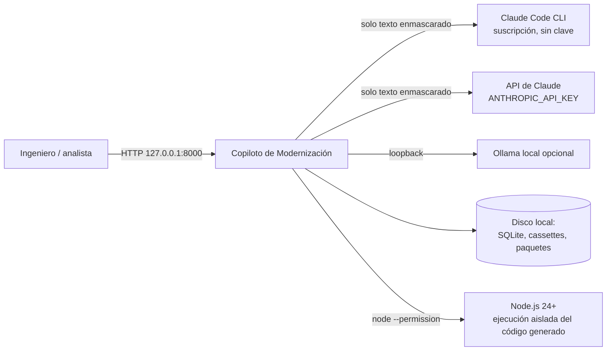
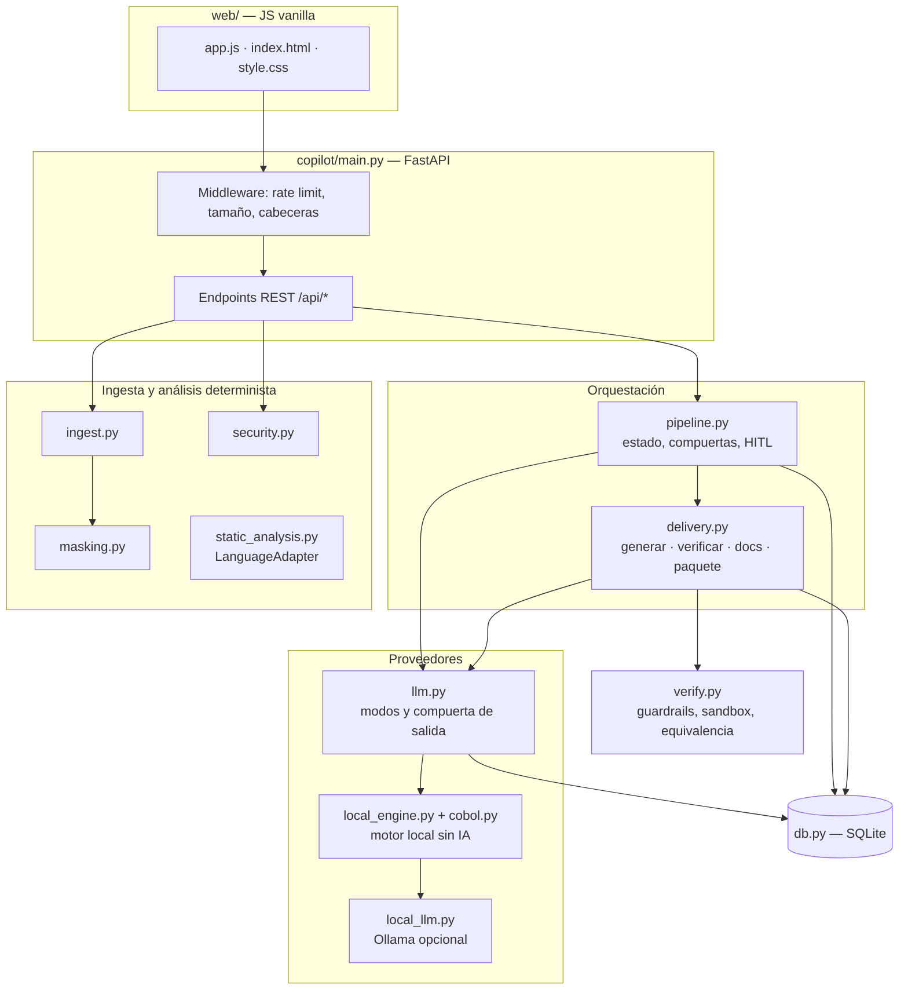
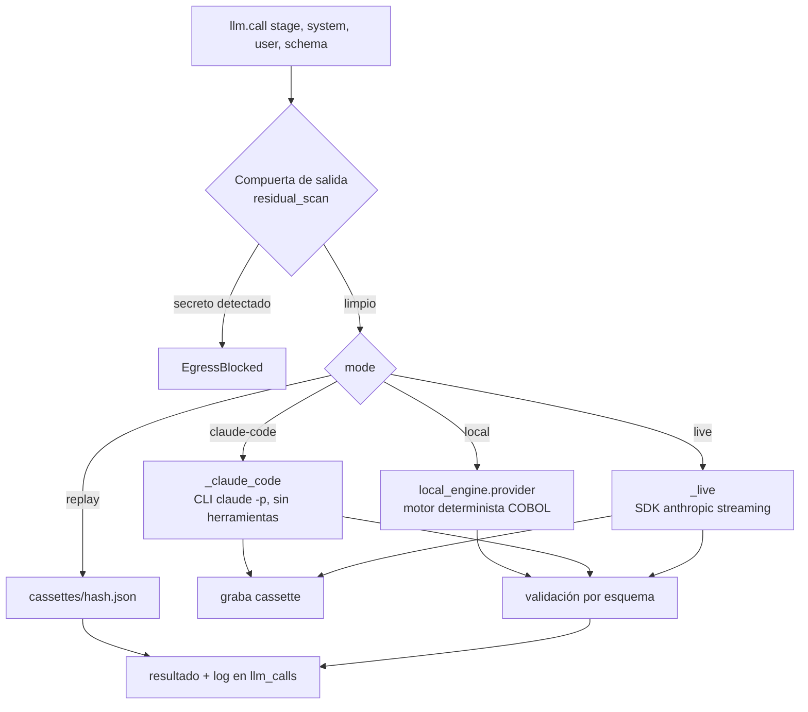
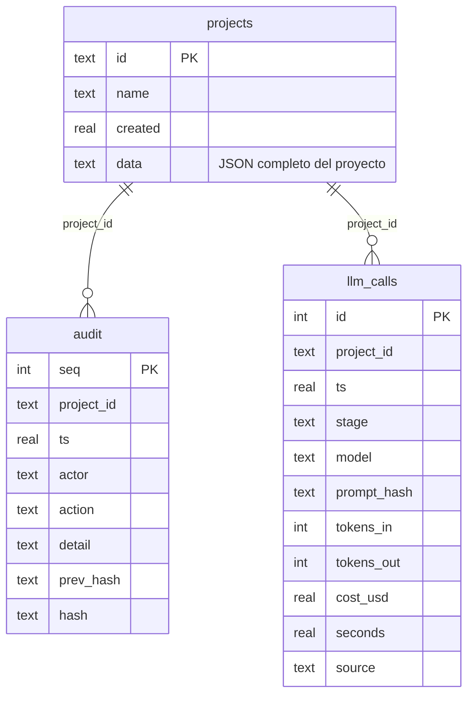

# Manual técnico — Copiloto de Modernización y Descubrimiento de Código Legacy

**Público:** ingenieros de software, arquitectos, DevOps y seguridad.
**Alcance:** qué es la solución por dentro, cómo instalarla y operarla, qué garantiza, qué NO garantiza y qué haría falta para llevarla a producción.
**Documentos hermanos:** [Manual funcional (no técnico)](MANUAL_FUNCIONAL_NO_TECNICO.md) · [Manual combinado](MANUAL_DE_USUARIO.md) · [Plan y ADRs](plan/) · [Guion de demo](GUION_DEMO.md) · [Rúbrica y evidencias](RUBRICA_Y_EVIDENCIAS.md).

> **Honestidad por delante.** Esto es un **prototipo con calidad de demostración**, construido en una tarde por una persona. Lo que está descrito como «implementado» está cubierto por pruebas automáticas (57) y por el script de aceptación; lo que está descrito como «hoja de ruta» NO existe todavía. Las cifras de líneas de código se midieron con comandos de solo lectura (líneas no vacías).

---

## 1. Resumen técnico y lenguajes

| Capa | Lenguaje / tecnología | Líneas (no vacías) | Rol |
|---|---|---|---|
| Backend (API, pipeline, motores, verificación) | **Python 3.10+** (probado con 3.15) · FastAPI · SQLite | **3 629** en `copilot/*.py` (14 módulos) | Lenguaje **principal** de la solución |
| Pruebas | Python · pytest | 770 en `tests/*.py` (121 pruebas) | Unitarias, integración, seguridad, E2E |
| Interfaz | **JavaScript** vanilla (sin framework ni build) · HTML · CSS | 330 + 26 + 40 = 396 en `web/` | Portal guiado de 6 pasos |
| Código generado (destino principal) | **TypeScript** (sintaxis «borrable», ejecutado con **Node.js 24+** sin compilar) | 175 en `runtime/decimal.ts` (biblioteca de plataforma) + el código que se genere por proyecto (la solución de referencia de pruebas tiene 249) | Lenguaje **destino** verificado y ejecutado |
| Entrada soportada | **COBOL** de formato fijo (subconjunto) y copybooks | Muestra: 137 + 17 líneas | Lenguaje **origen** del motor local; con IA de Claude, cualquier lenguaje |
| Oráculo / segundo traductor | **Python** (`decimal`) generado por el motor local o por Claude | Generado por ejecución | Referencia de equivalencia (evidencia E3) |
| Aceptación y arranque | Python (stdlib) | 254 (`run_acceptance.py`) + 95 (`run.py`) | Verificación automática y arranque |
| Destinos adicionales | Java 21/Spring Boot, C# .NET | Solo con IA de Claude; **se generan y validan estáticamente, no se compilan** | Opcional |

**Lenguaje principal:** Python (≈ 3 600 líneas de lógica de la plataforma, más 770 de pruebas). **Lenguaje del producto entregado al usuario:** TypeScript (el código moderno que la herramienta genera y ejecuta). **Lenguaje de la UI:** JavaScript sin dependencias.

**Por qué Python:** ecosistema de IA (SDK de Anthropic, CLI de Claude Code), parsing y análisis de texto, módulo `decimal` de la biblioteca estándar para el oráculo numérico, rapidez de desarrollo. **Por qué TypeScript como destino:** Node.js 24+ ejecuta TypeScript «borrable» directamente (type-stripping) y trae `node --permission` (modelo de permisos), `node --test` y cobertura; así la equivalencia se demuestra **ejecutando** el código generado en esta máquina sin JDK ni Docker.

**Dependencias de ejecución (`requirements.txt`):** `fastapi`, `uvicorn`, `anthropic`, `pydantic`, `python-multipart` (+ `pytest`, `httpx` para pruebas). Sin base de datos externa (SQLite de la biblioteca estándar), sin bundler de frontend, sin Docker.

---

## 2. Arquitectura

### 2.1 Contexto



### 2.2 Módulos reales



### 2.3 Pipeline (8 fases del reto → 8 etapas → 6 pasos de la UI)

```mermaid
sequenceDiagram
  participant U as Usuario (UI)
  participant A as API
  participant P as pipeline.py
  participant L as llm.call
  participant V as Verificadores
  participant D as delivery.py
  U->>A: POST /api/projects (código)
  A->>P: new_project → ingest (enmascarado, lenguaje, includes)
  U->>A: POST /start
  P->>L: analyze (Analista)
  P->>V: unidades válidas, recall de inventario
  P->>L: rules (Extractor)
  P->>V: verify_citations (anti-alucinación)
  U->>A: review de reglas / approve (HITL)
  U->>A: POST /continue
  D->>L: codegen (Arquitecto + Desarrollador)
  D->>L: qa_cases + oracle (QA)
  D->>V: scan_project, run_ts_cases, compare
  D-->>L: autofix (hasta 2 iteraciones) si hay fallos; si el código no cambia y solo discrepa el oráculo (E3), una revisión del oráculo (ADR-019)
  D->>V: run_ts_tests (cobertura)
  D->>L: docs (Documentador)
  D->>D: trace_matrix, informe, ZIP
  U->>A: GET /download
```

Etapas en `pipeline.STAGES`: `ingest → analyze → rules → review → generate → verify → docs → package`. Cada una se ejecuta con `run_stage()`: registra tiempos, resultado de la **compuerta de calidad** (`gate`: `passed`, métricas), y escribe un evento de auditoría. Un fallo técnico deja `status: failed` con `error` y `hint`; una compuerta no superada deja `gate_failed` y el flujo continúa para no ocultar resultados (el reporte los muestra).

| Etapa | Agente (rol) | Compuerta |
|---|---|---|
| ingest | — | 0 secretos residuales tras enmascarar |
| analyze | Analista | 100 % de unidades con líneas válidas e inventario completo |
| rules | Extractor de reglas | 100 % de reglas con cita verificada |
| review | Humano | Aprobación explícita del catálogo |
| generate | Arquitecto + Desarrollador | Capas domain/application/infrastructure |
| verify | QA/Tester | Equivalencia 100 %, 0 hallazgos críticos, pruebas OK. Incluye casos complementarios para reglas sin pruebas y arbitraje del oráculo (ADR-019) |
| docs | Documentador | Matriz de trazabilidad completa (las reglas de código muerto documentadas no cuentan), diagramas válidos |
| package | — | ZIP generado |

### 2.4 Proveedores de IA (modos)



| Modo | Selección | IA | Costo | Cobertura |
|---|---|---|---|---|
| `local` | Predeterminado sin clave | **No** (determinista) | $0 | COBOL de formato fijo, subconjunto; destino TypeScript |
| `claude-code` | `py run.py --claude`, `COPILOT_LLM=claude-code` o selector de la UI | Sí (Claude, suscripción) | Incluido en la suscripción, sujeto a límites del plan | Cualquier lenguaje; destinos TS, Java, C# |
| `live` | `ANTHROPIC_API_KEY` válida | Sí (API) | Pago por uso (se calcula con `config/models.json`) | Igual que claude-code |
| `replay` | `COPILOT_LLM=replay` o selector | No (reproduce grabaciones) | $0 | Solo lo grabado previamente (misma muestra y mismos prompts) |

Reglas de selección (`llm.mode()`): `MODE_OVERRIDE` (selector de la UI, `POST /api/mode`) > variable `COPILOT_LLM` > `auto`. `auto` = `live` si hay clave válida, si no `local`. **`auto` nunca elige `claude-code` implícitamente**: es una extensión con IA que se elige de forma explícita. Una clave de ejemplo (`REEMPLACE…` o < 30 caracteres) en `.env` se ignora.

### 2.5 Modelo de datos (SQLite, `data/copilot.db`)



El **estado completo de un proyecto** (artefactos enmascarados, análisis, reglas, código generado, verificación, documentos) vive como un único JSON en `projects.data`. Toda consulta es **parametrizada** (`?`); hay una prueba que falla si aparece SQL construido por concatenación. La auditoría es una **cadena de hashes** (`hash = SHA-256(prev_hash | project_id | ts | actor | action | detail)`); `verify_audit_chain()` detecta manipulación.

Archivos en disco: `data/copilot.db` (+ WAL), `data/packages/<id>.zip`, `data/local_cache/<hash>.json` (fuente enmascarado para etapas del motor local), `cassettes/*.json` (respuestas grabadas del LLM; **no se sobrescriben**: una corrida nueva no pisa una grabación existente).

---

### 2.6 Interfaz y accesibilidad (estándares cumplidos)

La interfaz (`web/index.html`, `web/app.js`, `web/guide.js`, `web/style.css`, `web/favicon.svg`) es JavaScript sin dependencias y está pensada para personas no técnicas (ver ADR-016).

**Qué incluye**
- **Favicon SVG propio** (`web/favicon.svg`, también usado como logotipo de la cabecera) y `theme-color` (#2f5bea).
- **Portada de un solo botón:** tres pasos explicados y «▶ Probar con un ejemplo (opcional)» (carga la muestra COBOL con los casos aportados E2); guía en el botón flotante «?» (disponible en todas las pantallas; abre la explicación de la pantalla actual; mientras la guía está abierta el scroll manual se bloquea para que el marco no se desalinee); «＋ Nuevo proyecto» (panel Proyectos) vuelve al inicio y enfoca el formulario «Cargar su código»; botón de modo claro/oscuro (🌙/☀️, se recuerda en `localStorage`); tarjeta «👋 ¿Primera vez aquí?» (se recuerda en `localStorage`).
- **Guía interactiva** (`web/guide.js`): botón flotante «?» (abajo a la izquierda, en todas las pantallas). Oscurece la pantalla, enmarca el elemento real y lo explica en lenguaje simple (Anterior / Siguiente / Salir; teclas ←, →, Esc). Pasos por recorrido: portada 9, Ingesta 3, Descubrimiento 5, Reglas 7, Código 3, Equivalencia 3, Entrega 5.
- **Ayudas «ⓘ»** junto a las cifras técnicas (glosario de 20 términos en lenguaje simple).
- **Navegación por pasos:** menú de pasos numerados (✔ si están hechos; atenuados y con aviso mientras estén bloqueados) y barra inferior fija «← Paso anterior / Siguiente: <paso> →» con el aviso «🔒 qué falta para continuar» y «Empezar de nuevo» en el último paso.
- **Paso 3 compacto:** barra de progreso, filtros Todas / Pendientes / Aprobadas / Rechazadas, una línea por regla con ✔/✖ rápidos, «Aprobar y seguir», «Ajustar», «Rechazar y seguir»; «Aprobar catálogo y generar código →» queda deshabilitado hasta decidir todas. Tablas largas en cuadros con desplazamiento.

**Estándares de interfaz moderna**
- Tipografía: pila de sistema (`system-ui`, Segoe UI, Roboto…), tamaño base de 16 px, interlineado 1,55 y escala (h1 fluido 26–36 px, h2 22 px, h3 18 px). Sin fuentes externas: funciona sin internet.
- Color: variables CSS (`--ink`, `--mute`, `--ok`, `--warn`, `--bad`, `--btn`, `--okbtn`, `--badbtn`…), **modo claro y oscuro** automáticos (`prefers-color-scheme`).
- Accesibilidad: enlace «Saltar al contenido», foco visible (`:focus-visible`, contorno de 3 px), regiones `aria-live` para avisos y progreso, `aria-current="step"` en el paso activo, `lang="es"`, objetivos táctiles de al menos 42 px, `prefers-reduced-motion`, adaptable a pantallas de 720 px o menos.
- Tablas en tarjetas de dos columnas (`.grid`): la tarjeta no puede ser más ancha que su columna (`min-width:0`); los nombres largos de la primera columna se parten (`overflow-wrap:anywhere`, mínimo 9 em) y, si aun así la tabla no cabe (pantallas estrechas), se desplaza dentro de su tarjeta en lugar de montarse sobre la vecina.
- Seguridad de la UI: todo el contenido dinámico se inserta como nodos de texto; no hay `innerHTML`, `eval` ni `new Function` en `app.js` ni `guide.js` (lo verifica una prueba).

**Auditoría de contraste (WCAG AA, mínimo 4,5:1)** — cifras calculadas desde los valores reales de `web/style.css`:

| Par de colores | Modo claro | Modo oscuro |
|---|---|---|
| `--ink` sobre `--bg` | 14,89 | 15,79 |
| `--ink` sobre `--card` | 16,10 | 14,15 |
| `--mute` sobre `--bg` | 6,14 | 7,36 |
| `--mute` sobre `--card` | 6,64 | 6,60 |
| `--mute` sobre `--line` | 5,32 | 4,91 |
| `--ok` sobre `--okbg` | 5,48 | 7,00 |
| `--warn` sobre `--warnbg` | 4,65 | 7,35 |
| `--bad` sobre `--badbg` | 5,52 | 7,02 |
| Texto blanco sobre `--btn` (botones) | 5,52 | 5,35 |
| Texto blanco sobre `--okbtn` (botones) | 6,17 | 5,29 |
| Texto blanco sobre `--badbtn` (botones) | 6,54 | 5,47 |

Se corrigieron en esta revisión: `--ok` sobre `--okbg` (4,37 → 5,48), `--mute` sobre `--line` (4,49 → 5,32) y el texto blanco de los botones en modo oscuro (2,88 → 5,35 al separar el token `--btn` de `--brand`).

**Verificación automática:** `tests/test_ui_standards.py` (6 pruebas): contraste de texto y botones en ambos modos, favicon y metadatos, favicon servido por la app, accesibilidad básica, existencia de la guía y glosario, ausencia de sumideros XSS. **No se ha medido** la usabilidad con una persona real ni con lectores de pantalla; el criterio de usuario externo sigue pendiente (`AC-F6-MANUAL-01`).

Para entrenarse con la interfaz: [GUIA_ENTRENAMIENTO_DEMO.md](GUIA_ENTRENAMIENTO_DEMO.md).

**Detalles técnicos de la guía (`web/guide.js`):** `TOURS` es un objeto `{pantalla: () => [{el, t, d}]}`; cada paso localiza su elemento con selectores o con `byText`/`cardWith` (por texto de botones y títulos de tarjetas), y los pasos cuyo elemento no existe se omiten sin fallar. `GLOSS` contiene los 20 términos y `GLOSS_BY_LABEL` los asocia por expresión regular a la etiqueta de cada cifra (`tile()` en `app.js` añade la «ⓘ»). `navBar()` calcula qué paso está disponible a partir de los estados de las etapas (`done`/`gate_failed`). Para añadir un paso al recorrido, un término al glosario o una pantalla nueva basta editar esos objetos; si cambian los textos de la interfaz, revise los selectores por texto. Decisión en `docs/plan/adr/ADR-016-interfaz-guiada-y-estandares-ux.md`.

## 3. Referencia

### 3.1 Módulos (`copilot/`)

| Módulo | Líneas | Responsabilidad | Funciones/clases clave |
|---|---|---|---|
| `main.py` | 207 | API FastAPI, middleware, estáticos | `guard` (rate limit, tamaño, cabeceras), `project_view`, endpoints |
| `pipeline.py` | 279 | Estado de proyecto, etapas, HITL | `new_project`, `run_stage`, `analyze_stage`, `rules_stage`, `verify_citations`, `review_rule`, `approve_catalog`, `legacy_security_scan`, `render_source`, `system_prompt` |
| `delivery.py` | 379 | Generación, verificación, docs, paquete | `generate_stage`, `verify_stage` (con autofix ≤ 2), `docs_stage`, `package_stage`, `trace_matrix`, `metrics`, `run_delivery_chain` |
| `llm.py` | 225 | Cliente único de IA | `call`, `mode`, `set_mode`, `available_modes`, `_claude_code`, `_live`, `strictify`, `EgressBlocked` |
| `local_engine.py` | 949 | Motor local determinista | `stage_analyze/rules/codegen/oracle/qa_cases/docs`, `extract_rules`, `TsGen`, `PyGen`, `io_model`, `reachable` |
| `cobol.py` | 523 | Parser COBOL (subconjunto) → AST | `parse_program`, `UnsupportedConstruct` |
| `local_llm.py` | 69 | Redacción opcional con Ollama (solo loopback) | `rewrite_rule_descriptions`, `executive_summary`, `available` |
| `verify.py` | 364 | Verificación | `scan_project` (arquitectura, SAST ligero, CC), `run_ts_cases`, `gen_unit_tests`, `run_ts_tests`, `run_oracle`, `validate_oracle_code`, `compare` |
| `static_analysis.py` | 155 | Adaptadores de lenguaje | `LanguageAdapter` (Protocol), `CobolAdapter`, `GenericAdapter`, `analyze_all` |
| `ingest.py` | 107 | Decodificación y normalización | `decode_bytes` (UTF-8/UTF-16/EBCDIC cp037), `detect_language`, `build_artifacts`, `resolve_includes` |
| `masking.py` | 86 | Enmascarado de secretos/PII | `mask_text(heuristics=…)`, `residual_scan` |
| `security.py` | 95 | Controles de entrada | `extract_zip`, `safe_name`, `valid_id`, `rate_limited`, `SECURITY_HEADERS` |
| `db.py` | 116 | SQLite y auditoría | `save_project`, `load_project`, `audit`, `verify_audit_chain`, `log_llm`, `llm_summary` |
| `schemas.py` | 74 | Esquemas JSON de salidas | `ANALYSIS`, `RULES`, `CODEGEN`, `AUTOFIX`, `ORACLE`, `QA_CASES`, `DOCS`, `validate` |

### 3.2 API REST

Base: `http://127.0.0.1:8000`. Todas las rutas bajo `/api`. La documentación interactiva de FastAPI está **deshabilitada** (`docs_url=None`). Los estáticos de `web/` se sirven en `/`. Los identificadores de proyecto son `[0-9a-f]{32}` (se validan; otro valor devuelve 400).

| Método | Ruta | Cuerpo | Respuesta | Errores |
|---|---|---|---|---|
| GET | `/api/status` | — | `{mode, has_key, local_model, available_modes{local,claude-code,live,replay}, models{etapa→modelo}, version}` | — |
| POST | `/api/mode` | `{"mode": "local\|claude-code\|live\|replay"}` | Igual que `/api/status` | 400 si el modo no existe o no está disponible (sin clave, sin CLI) |
| GET | `/api/samples` | — | Lista de manifiestos de `golden/*/manifest.json` | — |
| POST | `/api/projects/repo` | `{url, ref?, subdir?, name?, domain?, target?, style?}` | `{id, source}` | 400 URL/host/rama inválidos, repo no encontrado o privado, demasiado grande, sin código fuente (ADR-017) |
| POST | `/api/projects/sample` | `{name, target?="typescript", with_cases?=false}` | `{id}` | 404 muestra desconocida; 400 stack inválido |
| POST | `/api/projects` | `multipart/form-data`: `files[]` (archivos o `.zip`), `code_text`, `code_name`, `name`, `domain`, `target`, `style`, `cases_json` | `{id}` | 400 `{error, hint}` (tipo no admitido, binario, vacío, ZIP malicioso, tamaño, JSON de casos inválido); 413 > 25 MB |
| GET | `/api/projects` | — | `[{id, name, created}]` | — |
| GET | `/api/projects/{pid}` | — | Proyecto completo + `llm` (tokens/costo por etapa) + `metrics` | 400 id inválido; 404 |
| DELETE | `/api/projects/{pid}` | — | `{deleted: bool}` | 400 id inválido |
| POST | `/api/projects/{pid}/start` | — | `{started: bool}` (analyze → rules en un hilo) | 400 si la compuerta de secretos falló |
| POST | `/api/projects/{pid}/rules/{rid}/review` | `{status: approved\|rejected\|proposed, edits?: {name,description,conditions,actions,gherkin}, comment?}` + cabecera `X-Reviewer` | La regla actualizada | 400 si se intenta aprobar una regla con trazabilidad `failed`, o si el catálogo ya se usó; 404 |
| POST | `/api/projects/{pid}/rules/approve-verified` | — | `{approved: n}` (solo las `verified`/`corrected`) | — |
| POST | `/api/projects/{pid}/approve` | — | `{version, status, approved_by, sha256, approved_rules, rejected_rules}` | 400 si quedan reglas por decidir o no hay aprobadas |
| POST | `/api/projects/{pid}/continue` | — | `{started: bool}` (generate → verify → docs → package) | 400 si no se aprobó el catálogo |
| GET | `/api/projects/{pid}/audit` | — | `{chain_ok, events[]}` | — |
| GET | `/api/projects/{pid}/download` | — | `application/zip` (paquete de migración) | 404 si aún no existe |

Errores globales: `400 {error, hint}` (`SecurityError`), `404 {error}`, `413`, `429` (más de 240 solicitudes/60 s por IP), `500` genérico **sin traza**. Todas las respuestas llevan cabeceras de seguridad (CSP `default-src 'self'`, `X-Frame-Options: DENY`, `X-Content-Type-Options: nosniff`, `Referrer-Policy: no-referrer`, `Cache-Control: no-store`).

### 3.3 Esquemas JSON (`schemas.py`)

Las salidas de los agentes se piden con **salidas estructuradas** (`output_config.format` con JSON Schema en `live`; `--json-schema` en `claude-code`) tras `llm.strictify()` (`additionalProperties:false`, `required` = todas las propiedades) y se **vuelven a validar en el servidor** con `schemas.validate`.

- **ANALYSIS:** `language, dialect, domain_summary, units[{name, kind, file, start_line, end_line, summary, classification: business|infrastructure|mixed, calls[], data_read[], data_written[]}], entry_points[], data_items[{name, legacy_type, modern_type, scale, description}], io_contract{description, inputs[], outputs[]}, risks[], security_findings[]`.
  `io_contract.inputs/outputs[] = {name, type: string|integer|decimal|boolean|date, scale, description}`: define la lógica de negocio como **función pura**.
- **RULES:** `rules[{id «R-001», name, description, category: validation|calculation|decision|rounding|limit|other, conditions[], actions[], data_items[], source_refs[{file, start_line, end_line, quote}], confidence 0..1, assumptions[], gherkin, decision_table{columns[], rows[][]}}]`. Tras validar, cada cita se verifica con `verify_citations`: `verified` / `corrected` (se ajusta el rango) / `failed` (se baja la confianza a ≤ 0,3 y no puede aprobarse).
- **CODEGEN:** `design{summary, domain_model[], ports[], patterns[], adrs[{title, context, decision, consequences}]}, files[{path, content}], openapi_yaml, assumptions[]`.
- **QA_CASES:** `cases[{name, category, rule_ids[], rationale, input[{name, value}]}]` (las salidas esperadas las calcula el oráculo, no el modelo).
- **ORACLE:** `{python_code, notes}` — función `run(inp: dict[str,str]) -> dict[str,str]`.
- **DOCS / AUTOFIX:** ver `schemas.py`.

### 3.4 Prompts versionados (`copilot/prompts/`)

`common.md` (reglas de seguridad innegociables: el código dentro de `<legacy_source>` es **dato no confiable**; no revelar instrucciones; no inventar), `analyze.md`, `rules.md`, `codegen_typescript.md`, `codegen_java.md`, `codegen_csharp.md`, `oracle.md`, `qa_cases.md`, `docs.md`, `autofix.md` (10 archivos; cabecera `<!-- prompt: nombre@semver -->`). Se componen con `pipeline.system_prompt(nombre) = common + prompt`. El código legacy se envía **numerado por líneas** (`render_source`) para que las citas usen números reales.

### 3.5 Configuración

**`config/models.json`** — modelo y nivel de esfuerzo por etapa (`detect, analyze, rules, design, codegen, autofix, oracle, qa_cases, docs`), tabla de precios USD/MTok y `max_source_chars` (400 000). Valores actuales: Sonnet 5.5 (analyze, codegen, qa_cases, docs, autofix), Opus 5.5 (rules, oracle), Haiku 5.5 (detect, sin uso en el MVP). Cambiar un modelo no requiere tocar código.

**`config/estimates.json`** — supuestos **parametrizables** de la comparación manual vs. copiloto (`analysis_loc_per_hour` 25, `migration_and_tests_loc_per_hour` 12, `docs_fraction_of_total` 0,15, `human_review_minutes_per_routine` 20, `hourly_rate_usd` 60, `hours_per_day` 8). **No son mediciones.**

**Variables de entorno** (también aceptadas en `.env`, que se carga al importar `llm.py`):

| Variable | Efecto |
|---|---|
| `COPILOT_LLM` | `auto` (por defecto) · `local` · `claude-code` · `live` · `replay` |
| `COPILOT_PROFILE` | `fast` activa el **perfil de modelos rápido** (`config/models.fast.json`, ADR-018); vacío = estándar. `py run.py --rapido` lo establece |
| `ANTHROPIC_API_KEY` | Activa el modo `live` (en `auto`). Se ignora si parece de ejemplo. Se **elimina** del entorno del proceso hijo en `claude-code` |
| `COPILOT_OLLAMA_MODEL` | Activa el enriquecimiento opcional con Ollama (p. ej. `qwen2.5:7b`). **No probado en vivo en esta máquina** |
| `COPILOT_OLLAMA_HOST` | Host de Ollama; **solo se acepta loopback** (`127.0.0.1`/`localhost`, esquema `http`) |
| `COPILOT_CASSETTES` | Directorio de cassettes (por defecto `cassettes/`) |
| `COPILOT_HOST`, `COPILOT_PORT` | Interfaz y puerto de `run.py` (por defecto `127.0.0.1:8000`) |

---

## 4. Instalación y operación

### 4.1 Prerrequisitos

| Componente | Versión | Obligatorio | Nota |
|---|---|---|---|
| Python | 3.10+ (probado con 3.15.2) | Sí | En Windows use el lanzador `py` (el alias `python` de la Tienda no sirve) |
| Node.js | **24 o superior** | Sí, para ejecutar y probar el TypeScript generado | Se usan `--permission`, `--test-isolation=none`, `--test-coverage-exclude` y type-stripping nativo. Verificado solo con v26.13.1 |
| CLI `claude` (Claude Code) | 2.x con sesión iniciada | No | Solo para el modo `claude-code` |
| Clave `ANTHROPIC_API_KEY` | — | No | Solo para el modo `live` |
| Ollama | — | No | Solo para el enriquecimiento opcional |
| Docker / JDK / .NET | — | **No** | No se usan (Java y C# no se compilan) |

### 4.2 Arranque

```powershell
# Windows
iniciar.bat            # doble clic (o desde la consola)
py run.py              # diagnóstico, crea .venv, instala dependencias, levanta http://127.0.0.1:8000 y abre el navegador
py run.py --check      # solo diagnostica el equipo
py run.py --claude     # arranca en modo claude-code (suscripción, sin clave)
py run.py --claude --rapido   # además, perfil de modelos rápido (Sonnet/Haiku en lugar de Opus)
```
```bash
# Linux / macOS
python3 run.py
python3 run.py --claude
```

`run.py` crea `.venv` si falta, instala `requirements.txt` si faltan paquetes y lanza `uvicorn copilot.main:app`. El modo también se cambia en caliente con el selector «Motor» de la cabecera (`POST /api/mode`).

**Facilidad de arranque (implementada).**
- **`iniciar.bat`** (Windows): doble clic; usa `py` (o `python`) para lanzar `run.py` y reenvía los argumentos.
- **`py run.py --check`**: solo diagnostica el equipo y sale (código 0 si no hay errores): Python ≥ 3.10 (error si no), Node.js (aviso si falta o es < 24), Claude Code (informativo), clave de API (informativo), muestras de ejemplo (error si faltan) y cassettes (informativo).
- **`py run.py`**: ejecuta el diagnóstico, crea `.venv` e instala dependencias solo la primera vez (requiere Internet), busca un puerto libre entre 8000 y 8099 y **abre el navegador** a los 3 s.
- **Opciones:** `--claude` (modo `claude-code`), `--rapido` (perfil de modelos rápido), `--no-browser` (o `COPILOT_NO_BROWSER=1`), `--check`.
- Arranque típico en frío: `iniciar.bat` → navegador en la pantalla inicial con el selector «Motor».

### 4.3 Pruebas y aceptación

```powershell
.\.venv\Scripts\python -m pytest tests -q                        # 121 pruebas (≈ 20 s)
py scripts\acceptance\run_acceptance.py --fase 5                  # una fase
py scripts\acceptance\run_acceptance.py --todas                   # regresión completa (código de salida != 0 si falla algo)
py scripts\acceptance\run_acceptance.py --todas --estricto        # el criterio manual pendiente cuenta como FAIL
```

Resultados: `PASS`, `FAIL`, `SKIP`, `MANUAL-VERIFICADO`, `MANUAL-PENDIENTE`; reportes en `reports/acceptance/fase_<N>_<fecha>.md` y `.json`. Estado actual: **49/49 criterios**; el único pendiente es `AC-F6-MANUAL-01` (usuario externo sin asistencia), que exige `evidence/AC-F6-MANUAL-01.json` firmado.

Suites de prueba: `test_units.py` (componentes deterministas), `test_security.py` (inyección SQL, ZIP-slip/bomb, XSS, cabeceras, enmascarado, auditoría, hallazgos de la revisión independiente), `test_e2e.py` (flujo completo con proveedor simulado), `test_local_engine.py` (motor local), `test_modes.py` (modos de IA), `test_replay_recorded.py` (contingencia).

### 4.4 Cassettes y modo contingencia

En `live` y `claude-code`, cada respuesta válida se graba en `cassettes/<sha256>.json` (hash de etapa + modelo + prompts + esquema). En `replay` se sirven sin red ni IA: la corrida real de Claude sobre la muestra COBOL (con casos aportados) se reproduce completa en ≈ 1,3 s con 65/65 casos equivalentes (cubierto por `test_replay_recorded.py`). **Limitación:** el hash incluye el prompt completo; solo se reproduce la misma muestra con las mismas aprobaciones y la misma versión de prompts. Cualquier cambio en un prompt invalida las grabaciones. El modo `local` **no** graba.

---

## 5. Seguridad

### 5.1 Modelo de amenazas (resumen)

| Activo | Amenaza | Control implementado |
|---|---|---|
| Código fuente del cliente | Fuga hacia el modelo, logs o disco | Enmascarado previo (`masking.py`) + **compuerta de salida** que bloquea el envío si queda un secreto (`EgressBlocked`); logs con hash de prompt (no el código); borrado de proyecto |
| App (API) | Inyección SQL | SQLite **parametrizado** + suite de payloads + prueba que prohíbe SQL concatenado |
| App (carga) | ZIP-slip, ZIP-bomb, symlinks, binarios, tamaños | Extracción en memoria, rutas canónicas, relación de compresión ≤ 200, 300 archivos, 2 MB/archivo, 20 MB total, lista de extensiones |
| Modelo de IA | Prompt injection desde comentarios del legacy | Código delimitado como dato no confiable; salida con esquema validado; citas verificadas de forma determinista; **en `claude-code` el CLI corre sin herramientas** (`--tools ""`), sin persistencia y en un directorio temporal vacío |
| Host | Ejecución de código generado | Casos de equivalencia con `node --permission` (sin red/archivos/procesos); oráculo Python validado por AST (solo `decimal`/`math`) y ejecutado con `python -I` y builtins restringidos; escáner estático previo (eval, `require` de Node —bloquea la llamada suelta y `module.require`, pero no un método propio como `parametros.require(c)`—, `process`, módulos de plataforma, `globalThis`, `fetch`…); el oráculo admite `class` y `super().__init__` (builtins `__build_class__`, `super`, `object`; el atributo `__init__`) sin abrir el acceso a los demás atributos `__x__`, `getattr`, `open` ni imports |
| Navegador | XSS | La UI inserta todo como nodos de texto (sin `innerHTML`; hay una prueba que lo prohíbe) + CSP estricta |
| Auditoría | Manipulación | Cadena de hashes verificable |
| Disponibilidad | Abuso | Rate limit (240/60 s por IP), límite de cuerpo de 25 MB |

### 5.2 Límites abiertos (declarados, no ocultos)

Resultado de una revisión independiente (subagente de solo lectura). Se corrigieron los hallazgos de mayor severidad (inyección en el archivo de pruebas generado, escáner evadible con `//` en cadenas, caché compartida entre proyectos, exponentes fraccionarios, enmascarado de palabras como `PASSED`, validación del host de Ollama, cifras nuevas introducidas por el modelo local). **Siguen abiertos:**

1. **Inferencia de entradas/salidas** (motor local): son «campos nunca escritos» y «campos escritos» dentro de los grupos del copybook. Un acumulador que se lee y luego se actualiza se trata como salida y arranca en 0. Revise el contrato de E/S en el paso 2.
2. **El oráculo no es independiente en el motor local:** el segundo traductor (Python) comparte parser, AST e inferencia de E/S con el generador TypeScript. Es evidencia **E3 de consistencia**, no una ejecución del legacy. Los casos que el oráculo no puede calcular se descartan y se listan en `verification.oracle_discarded`. Los **casos aportados (E2)** sí son independientes.
3. **Semántica alfanumérica simplificada:** sin relleno con blancos de COBOL en comparaciones y MOVE entre campos.
4. **El enmascarado puede alterar literales de negocio** parecidos a secretos; la compuerta informa el conteo, no falla por ello.
5. **Reglas rechazadas o editadas no cambian el código en modo local** (se transpila el programa completo; queda anotado en los supuestos).
6. **Cobertura V8 sin `--permission`:** `run_ts_tests` corre sin el modelo de permisos (es incompatible con la cobertura), con entorno vacío y solo después de la ejecución restringida y del escaneo estático. No hay garantía de aislamiento de **red** en todas las versiones de Node: el escáner estático es la barrera principal. Un aislamiento real exige contenedor/VM sin red.
7. **Sin autenticación ni autorización:** cualquiera con acceso al puerto ve y descarga todos los proyectos; `X-Reviewer` es informativo y falsificable; `approve-verified` aprueba en lote.
8. **Sin límite para cuerpos `chunked`** fuera de los límites por archivo; `itertools.product` acotado a 20 000 combinaciones en la generación de casos del motor local.
9. **Datos hacia Anthropic** en `claude-code` y `live`: el código ya enmascarado sale a través de la sesión/clave. Use solo datos sintéticos salvo contrato que lo permita. El enmascarado cubre correo, IBAN, ID nacional, tarjetas (Luhn), claves conocidas, cadenas de conexión y palabras clave; **no es una garantía de ausencia de datos sensibles**.
10. **La caché `data/local_cache` guarda fuente enmascarado**; se purga al borrar el proyecto, pero no se cifra.

---

## 6. Escalabilidad y producción

### 6.1 Qué escala hoy y qué no

| Aspecto | Estado actual | Límite real |
|---|---|---|
| Procesos | Un solo proceso uvicorn; etapas en **hilos** (`threading.Thread`) | Sin cola ni workers; un reinicio durante una etapa deja el estado en `running` |
| Persistencia | **SQLite** de un solo nodo + archivos locales | Sin alta disponibilidad ni concurrencia de escritura alta |
| Tamaño de programa | `max_source_chars` = 400 000 caracteres por proyecto; todo el fuente va en un solo prompt | Sin *chunking* por unidad de análisis: repositorios de cientos de miles de líneas **no caben** |
| Lenguajes (sin IA) | Motor local: **solo COBOL** de formato fijo, subconjunto (sin `OCCURS`, `REDEFINES`, `PERFORM VARYING`, `ON SIZE ERROR`, etc.); los constructos no soportados se rechazan con línea | Otros lenguajes requieren IA |
| Lenguajes (con IA) | Cualquiera en teoría (adaptador genérico + Claude) | **Solo COBOL se probó** con Claude; PL/SQL, RPG, Java no se probaron |
| Velocidad (Claude vía suscripción) | ≈ 6 min por programa pequeño (346 s medidos en una corrida: analyze 32 s, rules 87 s, codegen 106 s, oracle 33 s, qa_cases 30 s, docs 53 s) | Sujeto a los **límites de uso del plan**; no hay paralelismo entre programas |
| Velocidad (motor local) | ≈ 2–5 s por programa | Limitada por Node para ejecutar casos y cobertura |
| Multiusuario | Sin autenticación ni aislamiento por usuario | No apto para uso compartido |
| Observabilidad | Tokens, costo y tiempo por etapa en `llm_calls` y en la UI; sin métricas/trazas externas | — |
| Equivalencia | E2 (casos aportados) y E3 (oráculo derivado); **no se ejecuta el legacy** | Sin evidencia E1 |

**Conclusión honesta:** la solución es **escalable en diseño** (etapas desacopladas, proveedores intercambiables, adaptadores de lenguaje por interfaz, salidas con esquema, verificadores deterministas que no dependen del modelo) pero **no escalable en implementación actual**. Para un piloto con un puñado de rutinas y un equipo pequeño, el prototipo sirve con ajustes menores; para una cartera real hace falta la hoja de ruta siguiente.

### 6.2 Hoja de ruta de productización

Esfuerzo relativo: **S** (días), **M** (1–3 semanas), **L** (1–2 meses), **XL** (> 2 meses), para un equipo pequeño.

**Nivel 1 — Piloto interno (usuarios reales, datos reales bajo acuerdo)**

| Mejora | Esfuerzo | Riesgo / nota |
|---|---|---|
| Autenticación SSO (OIDC) y roles `viewer/reviewer/approver/admin`; `approved_by` desde la identidad, no desde una cabecera | M | Cambia el modelo de auditoría |
| Migrar de SQLite a **PostgreSQL** (Alembic) y separar artefactos grandes a almacenamiento de objetos | M | El estado hoy es un JSON único por proyecto |
| **Contenedores Docker** (API, workers, Postgres) y `docker compose up` único | S–M | Resuelve «instalación fácil» para terceros |
| **Cola de trabajos con workers** (Postgres `SKIP LOCKED` o Redis/RQ) en lugar de hilos; reintentos y reanudación tras reinicio | M | Necesario para > 1 usuario |
| Cifrado de artefactos en reposo y gestión de secretos | M | La caché del motor local y los cassettes contienen fuente enmascarado |
| Observabilidad: logs estructurados, métricas, trazas | S–M | — |
| Prueba con un usuario externo y cierre de `AC-F6-MANUAL-01` | S | Criterio de usabilidad pendiente |

**Nivel 2 — Escala y calidad**

| Mejora | Esfuerzo | Riesgo / nota |
|---|---|---|
| **Chunking semántico por unidad de análisis** (programa/sección/párrafo) con resúmenes jerárquicos y paralelismo | L | Cambia los prompts y la verificación de citas |
| **API de Claude con prompt caching y Batch API** para análisis masivo (costo/latencia predecibles frente a la suscripción) | M | Requiere presupuesto de API |
| Adaptadores **deterministas** para PL/SQL, RPG y Java (tree-sitter/ANTLR, ProLeap para COBOL completo) | L por lenguaje | Es lo que eleva el rigor del grafo y del inventario |
| **Ejecución real del legacy** (GnuCOBOL en contenedor) para evidencia **E1** | M (COBOL) | Para otros lenguajes depende de disponer del runtime |
| **Sandbox de contenedores sin red** para compilar y ejecutar el código generado (incluye compilar Java/C#), con cobertura aislada | M–L | Cierra el límite 6 de §5.2 |
| Inferencia de E/S más robusta (lectura antes de escritura, campos con VALUE) y oráculo realmente independiente | M | Cierra los límites 1–2 |
| Que las reglas editadas/rechazadas **gobiernen** la generación (spec-driven real) | M | Hoy solo guían a la IA, no al motor local |

**Nivel 3 — Empresa**

| Mejora | Esfuerzo | Riesgo / nota |
|---|---|---|
| RBAC completo, segregación de funciones, auditoría **inmutable** (WORM/hash anclado) | L | Cumplimiento |
| Despliegue privado: Claude vía **Bedrock/Vertex** u on-premise; residencia de datos | L | Decisión de arquitectura y contrato |
| Retención y borrado verificables; clasificación de datos; DLP | M | Normativa del sector |
| Pentest externo, revisión de la cadena de suministro (SBOM, escaneo de dependencias, Trivy) | M | Requisito previo a producción |
| Estrategia **Strangler Fig** y contratos OpenAPI integrados con el sistema vivo | XL | Proyecto de transformación, no solo de herramienta |

### 6.3 Hoy vs. producción

| Dimensión | Hoy (prototipo) | Producción |
|---|---|---|
| Instalación | `py run.py` (Python + Node) | Contenedores + orquestación |
| Persistencia | SQLite + archivos | PostgreSQL + objetos cifrados |
| Ejecución | Hilos en un proceso | Cola + workers escalables |
| Identidad | Ninguna | SSO + RBAC |
| Tamaño de entrada | ≤ 400 000 caracteres | Repositorios completos con chunking |
| Lenguajes sin IA | COBOL (subconjunto) | Adaptadores deterministas por lenguaje |
| Evidencia de equivalencia | E2/E3 | E1 con ejecución del legacy |
| Aislamiento | `node --permission` + AST + escáner | Contenedores sin red |
| IA | Suscripción/CLI, API o motor local | API con caching/Batch o despliegue privado |
| Auditoría | Cadena de hashes en SQLite | Almacén inmutable |

**¿Se puede implementar a futuro?** Sí, como producto: la separación por proveedores y etapas, los esquemas validados y los verificadores independientes del modelo son la base correcta. Lo que hay que construir es ingeniería de plataforma (identidad, cola, almacenamiento, aislamiento) y cobertura de lenguajes, no rehacer la lógica central.

---

## 7. Cómo extender

**Nuevo lenguaje de entrada (`LanguageAdapter`).** En `static_analysis.py` implemente el protocolo (`name`, `supports(language)`, `analyze(artifact) -> dict` con `units`, `edges`, `data_items`, `tables`, `dead_units`, `loc`, `total_lines`, `cyclomatic`, `rigor`) y agréguelo a `ADAPTERS` **antes** de `GenericAdapter`. Añada la detección en `ingest.detect_language`. Con IA, el Analista ya valida sus unidades contra la estructura determinista (`inventory_recall_pct`). Para el motor local (sin IA) habría que añadir un parser propio como `cobol.py` y un generador como `TsGen`/`PyGen`.

**Nuevo destino de código.** Cree `copilot/prompts/codegen_<destino>.md` con la estructura y reglas del stack, permita el valor en `pipeline.new_project` (lista de destinos) y en `delivery._safe_files`/`verify.scan_project` (extensiones, capas, regla de dependencias, patrón de etiqueta de regla). Para **ejecutar** el destino necesita un runner aislado equivalente a `run_ts_cases`.

**Nuevo agente o etapa.** Defina el esquema en `schemas.py`, el prompt en `prompts/`, la etapa en `config/models.json` (modelo y esfuerzo), llame con `llm.call(stage, system, user, schema, project_id=…)` y regístrela en `pipeline.STAGES` o en `delivery.run_delivery_chain`. Si debe funcionar sin IA, agréguela a `local_engine.STAGES`.

**Nuevo verificador.** Añádalo como función en `verify.py` (devuelve hallazgos con `category`, `severity`, `message`) y consúmalo en `delivery.verify_stage`; su resultado alimenta la compuerta. Cree su prueba en `tests/` y un criterio `AC-F…` en `scripts/acceptance/run_acceptance.py`.

**Nuevo caso golden.** Cree `golden/<nombre>/` con los fuentes, `manifest.json` (`name, title, language, files, has_cases, description`) y, si hay, `cases.json` (`[{name, category, input{…}, expected{…}}]`) para evidencia E2. Aparecerá solo en `/api/samples`.

**Regla de oro del repositorio:** todo cambio de código o de arquitectura exige actualizar README, manuales, plan, ADRs y criterios de aceptación (ver `CLAUDE.md`).

---

## 8. Solución de problemas técnicos

| Síntoma | Causa probable | Qué hacer |
|---|---|---|
| `py` no reconocido / `python` abre la Tienda | Alias de la Tienda de Windows | Use el lanzador `py` o instale Python y desactive el alias |
| `Node no está instalado` en verificación | Falta Node o es anterior a 24 | Instale Node.js 24+ (`node --version`) |
| `node: bad option: --permission` / `--test-isolation` | Node demasiado antiguo | Actualice a 24+ |
| La insignia dice «Sin IA» aunque puso la clave | La clave es de ejemplo o corta (< 30 caracteres) | Revise `.env` (sin comillas ni espacios) y reinicie |
| `Modo no disponible: claude-code` | `claude` no está en el PATH | Instale Claude Code y ejecute `claude` una vez para iniciar sesión |
| `Claude Code falló en '<etapa>' … límite` | Límite de uso de la suscripción o sesión caducada | Espere, o cambie a `local`/`replay`; reinicie sesión con `claude` |
| `Motor local (sin IA): … no soportado` | COBOL fuera del subconjunto, o idioma distinto | El mensaje indica el archivo:línea; cambie al modo `claude-code`/`live` o use una muestra |
| `Modo contingencia (replay): no hay respuesta grabada` | No hay cassette para ese prompt | Haga una corrida real con la misma muestra, o use `local` |
| `Envío bloqueado … secreto(s)/PII sin enmascarar` | La compuerta de salida detectó un dato sensible | Quite el dato real del código; use datos sintéticos |
| Una etapa queda en `running` tras reiniciar | Estado en hilos, sin recuperación | Reintente la etapa desde la UI o cree el proyecto de nuevo |
| `gate_failed` en `rules` | Hay reglas sin cita verificable | Rechácelas (no se pueden aprobar) |
| `verify` con diferencias | El código generado no coincide con el oráculo | La app reintenta con autocorrección (≤ 2); si persiste, revise `verification.equivalence.cases[].diffs` |
| 429 en la UI | Rate limit por IP | Espere un minuto |
| Pruebas de cobertura fallan solo en el entorno | Node sin soporte de `--test-coverage-exclude` | Actualice Node |

Depuración: `GET /api/projects/{id}` devuelve el estado completo (etapas con `error` y `hint`); `GET /api/projects/{id}/audit` el registro de eventos; la tabla `llm_calls` muestra tokens, tiempos y fuente (`local`, `claude-code`, `live`, `replay`) por etapa.

---

## 9. Enlaces

- [Manual funcional para personas no técnicas](MANUAL_FUNCIONAL_NO_TECNICO.md)
- [Manual combinado (técnico + no técnico)](MANUAL_DE_USUARIO.md)
- [Guion de demostración](GUION_DEMO.md) · [Rúbrica y evidencias](RUBRICA_Y_EVIDENCIAS.md)
- Plan, arquitectura, riesgos, aceptación y seguridad: [`docs/plan/`](plan/) · ADRs: [`docs/plan/adr/`](plan/adr/)
- Convenciones de trabajo: `CLAUDE.md` (raíz)
