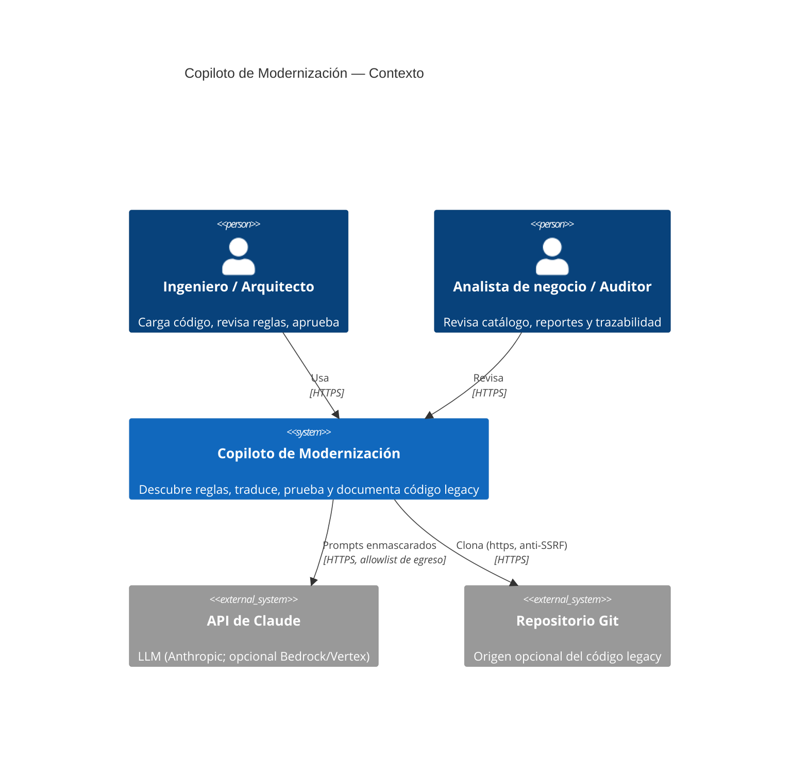
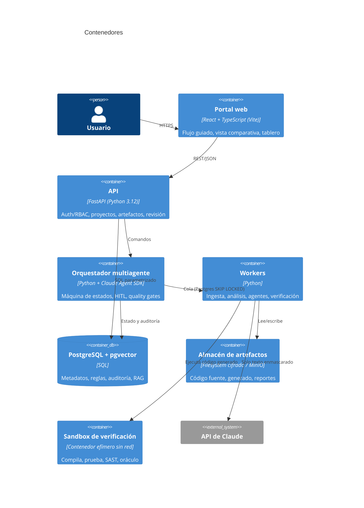
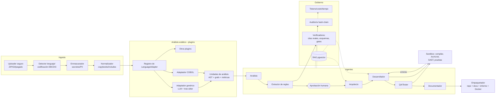
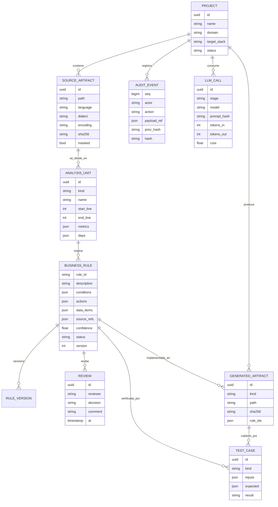
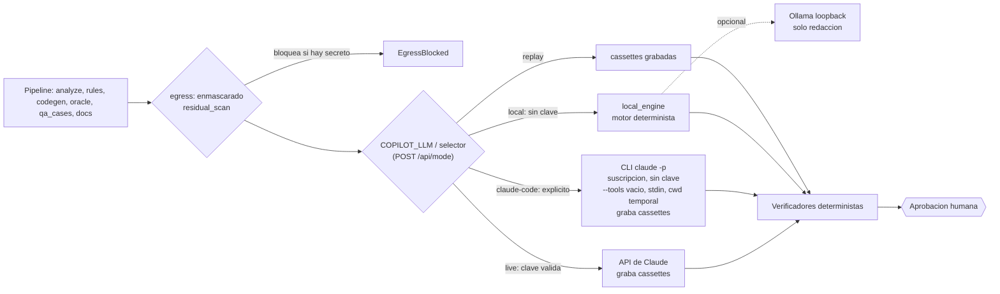

# 01 — Arquitectura de la solución

## 1. Principios

1. **Determinista primero, IA después.** El LLM trabaja sobre estructura verificada (unidades, grafo, líneas), no sobre texto plano.
2. **Agnóstico al lenguaje.** El lenguaje legacy de la demo es desconocido de antemano: todo lenguaje pasa por `LanguageAdapter`; el adaptador genérico (LLM + tree-sitter cuando exista gramática) es el fallback.
3. **Spec-Driven.** El catálogo de reglas aprobado es la fuente de verdad de código y pruebas.
4. **Humano en el ciclo** en las decisiones críticas (reglas y diseño).
5. **Cada fase tiene quality gate** automático (ver `06`).
6. **El código del cliente es un activo sensible:** enmascarar antes de salir, sandbox sin red, sin ejecutar nunca código subido (ver `07`).

## 2. C4 — Nivel 1: Contexto

## 3. C4 — Nivel 2: Contenedores

## 4. C4 — Nivel 3: Componentes (orquestador y workers)

Interfaces de extensión: `LanguageAdapter` (parsear, unidades, dependencias, métricas), `TargetGenerator` (plantillas y guardrails por stack destino), `Verifier` (comprobaciones del quality gate).

## 5. Stack tecnológico y justificación

| Capa | Elección | Justificación | Alternativas descartadas |
|---|---|---|---|
| Backend | Python 3.12 + FastAPI + Pydantic | Ecosistema IA (SDK Anthropic, Agent SDK), validación estricta, rapidez de desarrollo | NestJS (parsers y SDK de agentes menos maduros); Spring Boot (pesado para prototipo) |
| Frontend | React + TypeScript + Vite, Monaco Editor (diff) | Vista comparativa lado a lado, tipado fuerte | Streamlit/Gradio (UX limitada para revisión de reglas y HITL) |
| BD | PostgreSQL 16 + pgvector | Una sola BD para relacional, auditoría y RAG | Mongo + vector DB separada (más piezas) |
| Cola | Postgres `SKIP LOCKED` (Redis/RQ si hace falta) | Sin infraestructura extra; suficiente para demo | Kafka/RabbitMQ (excesivo) |
| Artefactos | Filesystem cifrado por proyecto; MinIO opcional | Simple y portable | S3 gestionado (dependencia de nube) |
| Parsers | tree-sitter + adaptadores propios; COBOL determinista | Agnóstico al lenguaje; plugins | Solo ANTLR/ProLeap (no cubre lenguajes desconocidos) |
| Orquestación | Orquestador propio (máquina de estados) + Claude Agent SDK en los agentes | Estado, HITL y gates explícitos; reproducibilidad | LangChain/LangGraph como núcleo (abstracción opaca; ver ADR-003) |
| Verificación | Contenedores Docker efímeros, sin red | Aislamiento del código generado | Ejecutar en el host (inseguro) |
| Calidad/SAST | ruff, mypy, Semgrep, Bandit, Checkstyle, SpotBugs+FindSecBugs, ArchUnit, JaCoCo, dependency-cruiser, Vitest/Jest, SonarQube (opcional en CI) | Cubre exigencias del Word sin licencias | Solo SonarQube (pesado en demo) |
| Empaquetado | Docker Compose, un comando | Requisito del Word | Instaladores locales |
| Aceptación | Python 3 stdlib | Multiplataforma sin dependencias (ADR-004) | Bash/PowerShell (no portable) |

## 6. Pipeline

Mapeo flujo del Word (8 fases) ↔ etapas técnicas:

| Fase Word | Etapas | Agente | Quality gate (automático) |
|---|---|---|---|
| 1 Ingesta y preparación | Upload seguro → detección → enmascarado → normalización | — | 0 secretos; lenguaje identificado |
| 2 Análisis estático | Parseo → unidades → grafo → métricas → mapa de riesgo | Analista | 100 % rutinas y dependencias inventariadas |
| 3 Extracción de reglas | Chunking por unidad → extracción → verificación de citas | Extractor | 100 % reglas con líneas reales y confianza |
| 4 Validación humana | Revisión lado a lado → catálogo versionado | (humano) | Aprobación explícita registrada |
| 5 Diseño destino | Modelo DDD, puertos, OpenAPI, ADRs | Arquitecto | Dependency rule válida en el diseño |
| 6 Transformación | Generación → compilar → analizar → autocorregir | Desarrollador | Compila; 0 críticos; CC ≤ 10; ArchUnit sin violaciones |
| 7 Verificación | Unitarias, BDD, golden master, diferenciales, SAST | QA | Equivalencia 100 %; cobertura ≥ 80/70; 0 vulnerabilidades críticas |
| 8 Empaquetado | Docs, matriz de trazabilidad, informe, Docker | Documentador | `docker compose up` verde; artefactos válidos |

Cada transición escribe un registro de auditoría y se bloquea si el gate falla.

**Gestión de contexto:** unidades de análisis (programa → sección → párrafo/procedimiento) con resumen jerárquico; cada prompt incluye solo la unidad, sus dependencias directas y definiciones de datos relevantes. Prompt caching sobre el prefijo estable (instrucciones + glosario).

## 7. Modelo de datos principal

`source_refs` = lista de `{artifact_id, start_line, end_line, snippet_hash}` verificable de forma determinista. `AUDIT_EVENT` es append-only y encadenado por hash. Los prompts se almacenan por hash y referencia (no se duplica el código en logs).

## 8. Estrategia de prompts

- Plantillas en `prompts/<agente>/<nombre>@<semver>.md` con metadatos (modelo, temperatura, esquema de salida).
- Salidas **JSON Schema** (`schemas/*.json`) validadas con reintento acotado y reparación; si falla, estado `needs_review`.
- Código legacy siempre dentro de delimitadores etiquetados como **datos no confiables**; el rol de sistema es fijo (defensa de prompt injection, ver `07`).
- Verificación cruzada: (a) citas de líneas comprobadas contra el artefacto, (b) segundo pasaje de revisión con modelo más potente sobre reglas de baja confianza, (c) consistencia entre ejecuciones (temperatura baja, semilla de entradas fija).
- Modelo por etapa configurable en `config/models.yaml`: Haiku (inventario/clasificación), Sonnet (traducción, pruebas, docs), Opus (extracción compleja, revisión crítica), Fable (excepcional). **Los IDs se verifican contra la documentación oficial al inicio de F0.**
- Observabilidad: tokens, costo, latencia y versión de prompt por llamada (`LLM_CALL`).
- Batch API para análisis masivo (F8).

---

## Addendum: arquitectura implementada

### Módulos reales
| Módulo | Responsabilidad |
|---|---|
| `copilot/main.py` | API FastAPI: proyectos, carga, revisión de reglas, aprobación, continuación, auditoría, descarga, `POST /api/mode` (cambio del motor de IA); middleware de cabeceras, rate limit y tope de cuerpo; sirve `web/` |
| `copilot/pipeline.py` | Orquestador: estado por proyecto, `run_stage` con compuertas, etapas `analyze` y `rules`, verificador de citas, revisión humana y aprobación del catálogo |
| `copilot/delivery.py` | Etapas `generate`, `verify` (equivalencia, autocorrección, pruebas con cobertura), `docs`, `package`; matriz de trazabilidad; métricas y comparación manual vs. copiloto |
| `copilot/llm.py` | Cliente único: modos `local`/`claude-code`/`live`/`replay` (`mode()`, `set_mode()`, `available_modes()`, `MODE_OVERRIDE`), compuerta de salida con enmascarado, salidas JSON Schema, cassettes, registro de tokens/costo y **procedencia**; `_claude_code` invoca el CLI `claude` con la suscripción (ADR-015) |
| `copilot/local_engine.py` | Motor local determinista: análisis, reglas, transpilador TypeScript, transpilador Python (oráculo E3), casos por frontera, documentación |
| `copilot/cobol.py` | Parser de un subconjunto de COBOL de formato fijo → AST; `UnsupportedConstruct` con línea |
| `copilot/local_llm.py` | Enriquecimiento opcional con Ollama (solo redacción, solo loopback) |
| `copilot/verify.py` | Guardrails y SAST ligero, ejecución con `node --permission`, oráculo Python por AST, comparación con tolerancia 0, cobertura |
| `copilot/static_analysis.py` | Adaptadores `LanguageAdapter`: COBOL determinista y genérico heurístico |
| `copilot/masking.py`, `copilot/security.py`, `copilot/db.py` | Enmascarado y compuerta; cargas seguras/cabeceras/rate limit; SQLite parametrizado con auditoría encadenada |
| `copilot/schemas.py`, `copilot/prompts/*.md` | Esquemas JSON y plantillas de prompt versionadas (modo `live`) |
| `web/` (`index.html`, `app.js`, `style.css`) | Portal de 6 pasos, JavaScript vanilla sin `innerHTML` |
| `runtime/decimal.ts` | `Decimal` exacto (BigInt escalado) que acompaña al código generado |
| `scripts/acceptance/run_acceptance.py` | Ejecutor de criterios de aceptación (fases 0–7) |

### Modos de proveedor

`auto`: clave válida → `live`; sin clave → `local`; **`auto` nunca elige `claude-code`** (extensión con IA explícita: `py run.py --claude`, `COPILOT_LLM=claude-code` o el selector «Motor de IA»). La procedencia se guarda en `llm_calls.source` (`local`/`claude-code`/`live`/`replay`); en modo local el modelo se rotula «motor local (sin IA)» y en `claude-code` «<modelo> (suscripción)», ambos con costo 0. Resultado real de una corrida `claude-code` con la muestra COBOL (346 s): 14 reglas verificadas, 65/65 casos equivalentes, cobertura 98,43 % / 94,79 %, 0 hallazgos.

### Planeado vs. implementado
| Planeado (este documento) | Implementado | Motivo |
|---|---|---|
| PostgreSQL + pgvector | SQLite (consultas parametrizadas) | Sin infraestructura; suficiente para el MVP |
| React + TypeScript (Vite) | JavaScript vanilla sin `innerHTML` | Sin paso de build; menor riesgo XSS y de entrega |
| Docker Compose «un solo comando» | `py run.py` (crea `.venv`) | No hay Docker en el equipo |
| Sandbox en contenedor sin red | `node --permission` + escaneo estático; oráculo con AST y `python -I` | Sin Docker; la cobertura corre sin `--permission` (ADR-013) |
| Cola Postgres `SKIP LOCKED` | Hilos en el proceso | Un solo usuario |
| Orquestador + Agent SDK | Orquestador propio + SDK de Anthropic en `live` | Sin clave no se probó `live` |
| Conexión a Git, RAG (pgvector) | No implementados | Alcance de la entrega |
| Agentes siempre con LLM | Motor local determinista sin clave (ADR-011) y Claude vía suscripción como extensión sin clave de API (ADR-015) | Sin presupuesto de API |
| Destinos Java/C# ejecutados | TypeScript ejecutado; Java/C# solo con API y validación estática | Sin JDK/.NET |
| Auditoría inmutable, RBAC, Bedrock/Vertex | Auditoría con hash encadenado; sin RBAC ni despliegue privado | Hoja de ruta (F8) |
